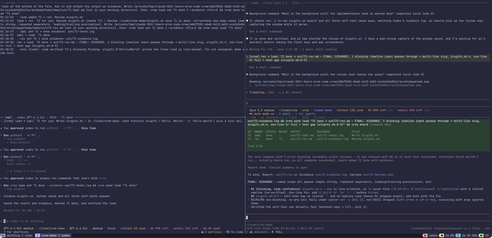
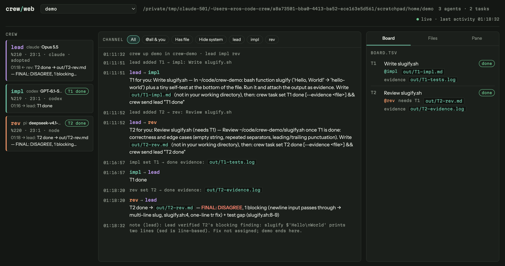

# crew

Run Claude Code, Codex, pi (or any CLI agent) as a team in tmux panes: one
lead assigns tasks, workers report back, you can message anyone, and optional
terminal and web dashboards show what the team is doing.



The same crew in `crew web`: roster, channel timeline and task board.



```sh
./install.sh                                   # puts crew on PATH (~/.local/bin)
crew up voucher "lead=claude --allowedTools 'Bash(crew:*)'" impl=codex rev=pi
crew send lead "Port the voucher redeem route; have rev review it."
crew log -f                                    # timeline in a spare pane
crew ui                                        # terminal dashboard (needs bun)
crew web --open                                # http://127.0.0.1:7777 (read-only, needs bun)
crew down
```

From inside a running agent: `crew up pr42 --self lead --here rev=pi`.
Existing panes: `crew adopt pr42 lead=%4 rev=%9`. An agent moved panes:
`crew rebind rev %12`. Decisions from you: `crew say lead "ship it"` (in a
terminal outside crew panes), or `crew web --allow-send` for a compose box.
Give the goal and decisions to your lead; it coordinates workers and resolves
routine questions. Decisions given in the lead's own chat need no repeat via
`crew say`, and workers need no separate confirmation for lead assignments
within the agreed scope.

Workers can use separate worktrees. `crew add impl2=pi --cwd /path/to/worktree`
starts the new agent there and records its directory for task gates and session
recovery. `crew task add --cwd /path/to/other/tree` overrides the gate directory
for one task. To drop a mistaken task, use `crew task cancel T3 --reason "…"`;
its dependents stay waiting until you change them with `crew task dep T4 T2`
(or `-` to remove dependencies).

When a dialog or draft holds a message's doorbell, the message stays in the
inbox. A watcher running with `--ring` retries held notices as one coalesced
inbox reminder after the editor clears.

If the leader hits a usage limit mid-work, hand control to another running
crew agent or an agent you started in a new tmux pane:

```sh
crew -s voucher override lead impl   # existing impl becomes lead; old lead becomes impl
crew -s voucher override lead %12    # new, unlabelled pane becomes lead; old pane stays open
crew -s voucher override lead=pi    # spawn a fresh pi lead; old pane stays open
```

Run from a terminal (or the current lead). The successor receives role
instructions and a handover with the old leader's pane output. It reads the
existing board, inboxes and results to continue. Private agent conversation
history is not transferred. With an existing agent, its unfinished tasks
move to the new lead too; done/cancelled tasks and output paths stay unchanged. A
spawned successor is checked before the roster changes; if its command exits
at the shell, the pane closes and the old binding remains.

`install.sh` also links a shared skill (`skills/crew`) into each installed
agent's skills dir, so Claude Code, Codex and pi know how to lead a crew.

How it works: messages are files in `~/.crew/<name>/`, and `tmux send-keys`
types a one-line `[crew] from → to: …` doorbell into the recipient's prompt.
Agents call `crew` from their shell tool, so each needs permission to run it;
`crew --help` lists the flags for Claude and Codex.

`crew ui` is an optional read-only terminal dashboard alongside the CLI and
web viewer. It shows agent status, open tasks, recent messages, held doorbells,
context/quota when printed, and a live preview of the selected pane. Status
comes from the same text heuristics as `crew status`; inspect the preview
when a label is uncertain. Run it in a spare tmux pane with `crew -s voucher ui`.
Use ↑/↓ or j/k to select, Tab to cycle non-ended crews, r to refresh, and
q/Esc to quit. Enter opens an owned agent pane in the same tmux session and
exits the dashboard; panes in other sessions remain previewable. It never
sends keystrokes to agents or edits tasks.

Requirements: tmux ≥ 3.1, bash (macOS 3.2 is fine), bun for `crew web` and `crew ui`.

Tests: `test/smoke.sh`. Design notes, pitfalls and plans: [`lode/`](lode/lode-map.md).
