# State files (`~/.crew/<name>/`)

All plain text; tabs separate TSV fields; newlines/tabs inside message text are
flattened to spaces by `oneline()` before logging.

```mermaid
flowchart TD
  home["~/.crew/"] --> cur[".current  (name of the default crew)"]
  home --> d["name/"]
  d --> panes["panes  role⇥pane⇥cli⇥origin"]
  d --> cwd["cwd.tsv  role⇥directory"]
  d --> pending["pending/role  held-count"]
  d --> sessions["sessions.tsv  role⇥cli⇥cwd⇥session-id⇥launch-epoch"]
  d --> meta["meta  key=value"]
  d --> board["board.tsv  id⇥owner⇥status⇥dep⇥out⇥title⇥evidence"]
  d --> log["channel.log  time⇥kind⇥from⇥to⇥text"]
  d --> inbox["inbox/role.md  full message text"]
  d --> out["out/  result files"]
  d --> roles["roles/role.md  rendered instructions"]
  d --> timers["timers/id/ config, owner, next/claimed, message, dispatch lock"]
  d --> slots["locks/name/ max, slot.pid.random/owner + workload + run + held"]
  d --> ended["ended  (exists after crew down)"]
  d --> lock[".board.lock/ .panes.lock/  (dirs, held during rewrites)"]
  d --> rlock[".ring<pane>.lock/  (dir, held while typing a doorbell)"]
```



## `panes`

```
lead	%124	2.1.284	adopted
rev	%132	pi	spawned
rev2	%133	codex -c sandbox_workspace_write.network_access=true …	spawned
```

- `cli` is the role spec as typed (spawned) or the detected program (adopted,
  `--self`, rebound: `claude`, `pi`, `codex`). Crews created before detection
  existed may hold `2.1.284` (Claude) or `node` (pi).
- Added to by `crew add`, rewritten by `crew rebind` or `crew override`, under `.panes.lock`.
  Overrides also hold `.board.lock` while transferring unfinished replacement
  tasks; done/cancelled task owners and output paths stay unchanged.
- `origin` is `spawned` or `adopted`. Files written before this column existed
  have 3 fields; readers default a missing origin to `spawned`.

## `sessions.tsv`

```
lead\tclaude\t/private/tmp/project\t8eaf…\t1790676001
```

Session rows are keyed by role, CLI and that role's recorded directory
(`cwd.tsv`, falling back to `meta cwd`). The fifth
field is the launch epoch; spawn writes it with an empty ID before starting a
supported CLI. A later crew command lazily records one unique native session
created at or after that epoch, excluding IDs already assigned to other roles.
Older four-field rows remain valid. `crew session <role> <id>` pins an ID
explicitly; legacy fallback considers only sessions at or after crew start and
refuses when same-CLI roles share the folder. A different CLI or cwd makes a
record stale and ignored. Native store layouts and ambiguity handling are in
[../cli/sessions.md](../cli/sessions.md).

## Role directories and pending doorbells

`cwd.tsv` contains optional `role<TAB>directory` rows. Missing entries use
`meta cwd`; panes retain their original four-column schema. Writes and role
removal serialize with `.panes.lock`; role swaps move directory rows with panes.

`pending/<role>` contains one decimal held-delivery count. The counter follows
the role's inbox; replay targets only its current owned pane. Its focused
`pending/.<role>.lock` serializes held increments and a nonblocking replay;
temporary writes are renamed into place. Only a ringing watcher consumes the
counter after a successful guarded reminder. Stdout watch leaves it alone.
The inbox is unchanged by replay. The existing ring lock still serializes pane
input. See [../cli/messaging.md](../cli/messaging.md#held-doorbell-reminders).

## `meta`

```
mode=up            # or adopt
window=@47         # window crew up created or split into
here=0             # 1 when --here split the caller's window
tmux_session=fsfe
created=2026-09-29T17:00:01
created_epoch=1790676001
cwd=/private/tmp/tryout-pr358
```

`created_epoch` is the numeric crew-start time used to exclude older native
sessions during fallback discovery. It is absent in older crew directories,
which use `created` or the `meta` file timestamp as a fallback.

## `board.tsv`

```
T1	rev	done	-	out/T1-rev.md	Round 1: independent review of PR #358	out/T1-tests.log
T2	rev2	queued	T1	out/R2-rev2.md	Cross-check	-
```

Ids are `T<max existing numeric id + 1>`, allocated under `.board.lock` (mkdir lock, 5 s
timeout, released by an EXIT trap even on `die`). `out` is set at add time
(`--out` or `out/<id>-<owner>.md`); `dep` and `evidence` use `-` for none.
Rows written before the evidence column have 6 fields; `board`, `task set`
and the web viewer treat a missing 7th as `-`. An optional 8th field is the
task's `--gate` command (`-` for none). New rows add field 9: the physical
directory snapshotted at task creation, preserved across owner changes.
Legacy rows without it use the owner's recorded directory. `cancelled` rows
are retained and count as closed, without satisfying dependencies. See
[../cli/tasks.md](../cli/tasks.md) and [../cli/worktrees.md](../cli/worktrees.md).

## `channel.log`

```
2026-09-29T17:20:14	sys	lead	rev	lead added T1 → rev: Round 1 …
2026-09-29T17:20:14	dm	lead	rev	T1 for you: … Write /Users/…/out/T1-rev.md …
2026-09-29T17:24:02	all	you	all	pause
```

`kind` is `sys` (events, notes, rebinds), `dm` (to one role or `you`) or
`all` (broadcast). `from` is a role, `you` or `outside`; `from`/`to` are `-`
for pure system lines. The log does not record *how* `you` sent (terminal vs
web); the doorbell and inbox heading do.

## Timers

`timers/timer-<epoch>-<pid>/` holds `config` (`at|every|watch⇥interval-seconds⇥role`),
`owner` (`pid⇥process-start-time`), `next`/`claimed` (epoch), `message` (literal full text),
`ready` (publication marker) and `worker.log`. `done` / `cancelled` markers
retain completed/cancelled history. A `watch` record writes `next` once at
publication and never advances it; `crew timers` prints `-` for it. The
crew-wide `.timers.lock` serializes
publication, schedule claims and shutdown markers. Each timer's
`.dispatch.lock` serializes pane dispatch with cancellation; pane I/O never
holds the crew-wide lock. See
[../cli/timers.md](../cli/timers.md).

## Command semaphore slots

`locks/<name>/max` records the capacity fixed on first use. Each temporary
`slot.<pid>.<random>/` directory reserves one slot before admission;
`owner` stores `wrapper-pid⇥UTC-start-time⇥role⇥command`, `workload` stores
`command-pid⇥UTC-start-time`, `run` releases the published workload gate,
and `held` marks an admitted command. Empty/unpublished slots still identify their owner through
the directory name. A live wrapper or live workload retains its reservation; process identity
uses explicit C locale/UTC start times. Dead/reused-pid reservations are
removed during acquisition; completed/interrupted commands remove their own slot. This
state is separate from the board/pane rewrite locks. See
[../cli/semaphore.md](../cli/semaphore.md).

## Lifecycle

- `crew up`/`adopt` refuse a name whose dir exists without `ended`. An ended
  dir is moved aside to `<name>.<timestamp>` and a fresh one created. The
  moved-aside folder keeps `meta`, `panes` and `ended`, so `crew sweep
  --delete-older` sees it as an ordinary ended crew.
- `crew down` writes `ended`, clears `.current` if it pointed here, and keeps
  every file for later reading (`crew -s name log`, the web viewer).
- `crew sweep --apply` does the same bookkeeping only when no recorded pane
  passes `owns_pane`, under `.panes.lock`; it never changes pane labels or
  closes panes. Default `crew sweep` is read-only. [Listing](../cli/listing.md)
  computes real liveness rather than trusting the absence of `ended`.
- `crew sweep --delete-older <age> --apply` is the only command that removes a
  crew directory: it ends nothing and deletes only folders that are ended,
  hold `meta` and `panes`, are older than the cutoff by their last
  `channel.log` line, and are not the `.current` crew. It re-checks under the
  folder's own `.panes.lock` and never touches non-crew directories; the
  folder's files (board, inboxes, results, timeline) are gone afterwards, so
  export anything worth keeping first. See
  [listing.md](../cli/listing.md#prune-contract---delete-older).
- `pane_session` (lookup by pane id) skips ended crews.

Related: [summary.md](summary.md), [../cli/tasks.md](../cli/tasks.md).
