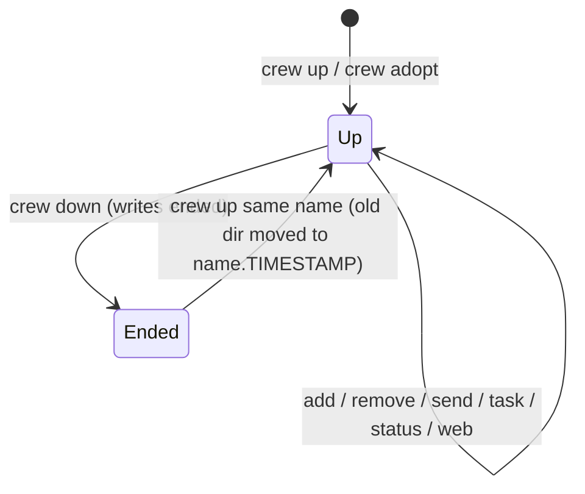
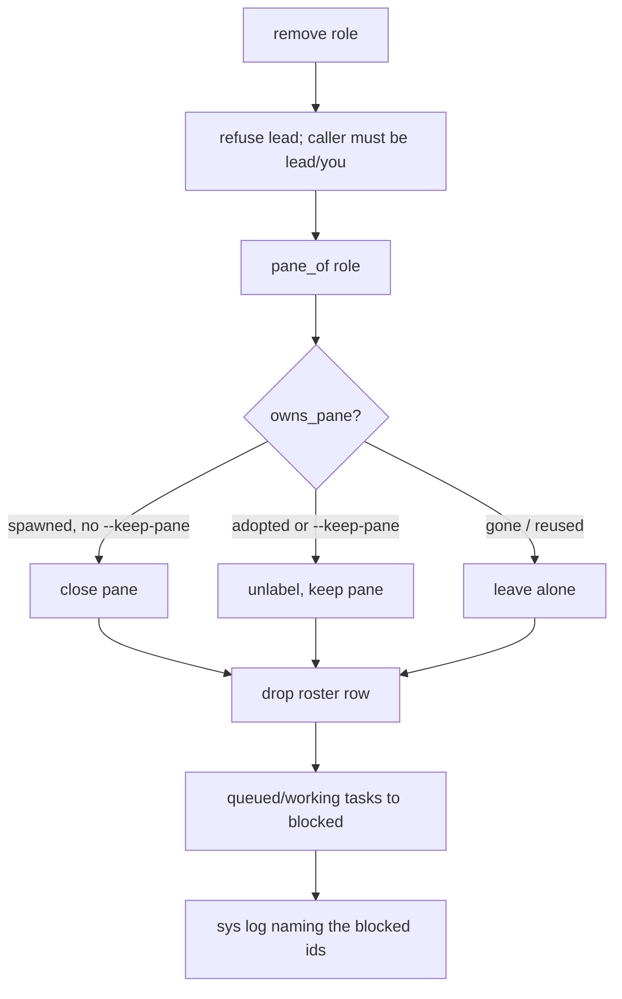

# Crew lifecycle: up, add, adopt, remove, down



## `crew up <name> [options] role=cli …`

1. Parse `--in <tmux-session>`, `--self <role>`, `--here`, `--no-watch`;
   anything else starting with `-` is an error; `x=y` args are role specs.
   `CREW_WATCH_EVERY` (a duration) must be positive and is checked here, before
   any crew directory exists.
2. Target session: `--in`, else the caller's (`display -p -t "$TMUX_PANE" '#S'`).
   `--self`/`--here` require a live `$TMUX_PANE`, resolved before creating
   crew files. A missing/dead id fails without leaving a crew directory.
3. `check_roles` on every spec (and `--self`): valid name, non-empty value,
   no duplicates. It runs before anything exists, so a bad spec can't leave
   orphan panes or a crew dir that blocks the name.
   Then `init_dir`: refuse if the crew is up; move an ended one aside; create dirs.
4. `--self R`: label the validated caller pane as `R`, record it as `adopted`.
   Warn when its detected CLI is a filter/pager (`tail`, `head`, `less`, `more`,
   `cat`), and print the role, pane and CLI near the final output. Do not guess
   a different pane: a live but incorrect `TMUX_PANE` needs explicit `rebind`.
5. For each spec: first pane via `new-window -d -n <name>` (or, with `--here`,
   `split-window` into the caller's window), the rest via `split-window` +
   `select-layout tiled`. Each gets `-e CREW_SESSION -e CREW_AGENT -e CREW_HOME`
   and `-c "$PWD"`. Record as `spawned`.
6. Write `meta`, `.current`, render role files, log a `sys` line.
7. For supported CLIs, record each role's launch epoch with an empty session
   ID before typing the spec into its pane. Then warn if a codex spec is
   sandboxed without network access ([../agents/codex.md](../agents/codex.md)).
8. In parallel per pane: `wait_ready` (screen `cksum` unchanged twice, ≥3 s,
   max `CREW_BOOT_WAIT`). If `detect_cli` finds only a shell, the command
   failed (see Readiness): warn with the pane's last line and send no intro.
   Otherwise `intro` (which refuses dialogs, see Readiness), then `refresh_model`.
   Session IDs are captured lazily on a later crew command, after the CLI has
   received its first message and created its native session file (see
   [sessions.md](sessions.md)).
9. With a lead role and no `--no-watch`, start the detached watcher: a timer
   record of kind `watch` whose worker scans panes and rings the lead
   ([watch.md](watch.md), [timers.md](timers.md)). It is published through the
   same launcher/ready handshake as a timer, so `crew timers` lists it and
   `down` stops it; a failure is a warning, never a failed `up`. This runs
   after the settle phase, so the watcher never sees a half-started crew.
10. `select-window` to the new window unless `--self`, `--here` or `CREW_NO_SWITCH`.
11. Print `ready. files: <dir>`, then the `watch: <id>` line, then (with
    `--self`) the intro line on stdout: the calling agent reads it from its own
    command output instead of having it typed into its prompt.

```sh
crew up voucher lead=claude impl=codex rev=pi          # new window "voucher"
crew up pr358 --self lead --here "rev2=codex -c …" rev=pi   # agent starts its own crew
crew up quiet lead=claude impl=codex --no-watch      # no detached watcher
```

A pipeline fixture running `crew up --self lead --here … | tail -20` inside a
throwaway pane keeps the correct pane id but detects the pipeline's `tail` as
the CLI. This reproduces filter detection, not the historical wrong-id report.
The report's Claude `!` transient-pane cause remains unverified. Avoid a pipe,
check the printed binding and rebind explicitly if needed.

`--here` re-tiles the caller's window, resizing the user's existing panes.

## `crew adopt <name> role=<pane> …`

Pane refs are anything tmux resolves: `%7`, `.2`, `6.1`. `check_roles` and
resolving every ref (`resolve_pane_specs`; the same pane twice is refused) happen before
`init_dir`, so a bad ref labels nothing. `pane_id` treats empty output as
not found: tmux 3.5 `display-message -p -t %999999` prints nothing and exits 0.
Then it labels each pane,
styles its window, records it as `adopted` with the detected program as cli
(`detect_cli`, [summary.md](summary.md)),
renders role files, rings the intro into every pane. Nothing is started or
moved. Adopted agents can't get `CREW_*` env vars, so identity comes from the
pane-id lookup.

## `crew add [--cwd <dir>] role=<cli spec|%pane|fork:role> …`

```sh
crew -s voucher add "rev2=pi" impl2=%12
crew -s voucher add rev2=fork:lead
```

- Requires a running crew. Holds `.panes.lock` through validation, roster
  writes and command launches, then releases it before settling and intros.
  Validate all roles and adopted panes: no duplicates, missing panes, panes
  already bound here, or panes labelled by another crew.
- CLI specs split the recorded `meta window` (including `--here`). The window
  must contain an owned crew pane; if agents moved, use the first owned pane's
  window instead. With no owned pane, rebind or adopt a pane before spawning.
  New panes use `--cwd`, the source directory for forks, or `meta cwd`; see
  [worktrees.md](worktrees.md). Propagate `CREW_HOME`, `CREW_SESSION`, `CREW_AGENT`.
- `role=fork:<source-role>` creates a spawned role by forking the source's
  native conversation. It uses the source role's recorded or safely discovered
  exact session ID and native CLI command; if another same-CLI role makes the
  source ambiguous, pin its ID first with `crew session <source-role> <id>`.
  The new role keeps the source CLI spec in `panes`; fork-specific native
  options are used only for its launch. Crew records a launch epoch with a
  blank ID before starting it. A later role command lazily captures the ID
  after the CLI creates its native file; pin it explicitly if capture is
  ambiguous.
- Spawn each resolved command through the shared pane helper, which sets the
  crew environment and working directory. Plain CLI specs are typed verbatim;
  fork specs add only native fork arguments. Record new panes as `spawned`.
  Settling checks `detect_cli`; a command back at the shell gets no intro,
  and the warning gives recovery instructions for its registered role.
  `%pane` adopts an unlabelled existing pane, keeps its window, detects its
  CLI, and records it as `adopted`.
- `resolve_pane_specs` is shared with `adopt`: resolve pane refs, refuse the
  same pane twice, and normalize each spec into `role|pane|origin|cli`.
  Spawning specs start with an empty pane; creation fills it. CLI is last,
  so literal pipes in the user command survive `read`. These records are
  transient; persisted `panes` rows keep their existing TSV format. `add`
  alone rejects already-bound/labelled adopted panes; `adopt` keeps its
  existing validation rules.
- `crew_window` selects the stored window when it contains an owned pane,
  otherwise the first owned pane's window; it fails when none is owned.
- Render only new role files with `write_role_file`. Existing files stay
  untouched. All role files point to the live `panes` file and `crew status`
  rather than embedding a roster snapshot.
- Log a `sys` line, release the lock, and send intros using the same
  dialog checks as `up`. An intro to the caller prints on stdout.
- Before each spawned CLI starts, record its launch epoch with no session ID.
  A later crew command captures one unique new session after the CLI creates
  its native file; ambiguous launches stay unrecorded.
- `owns_pane` is checked again before intros. Failed commands get no intro;
  startup dialogs get no input and print a manual follow-up command.
  Existing agents are not restarted or rung. `down` follows each addition's
  spawned/adopted origin.

## `crew down`

First hold `.timers.lock`, mark the crew ended and its timers cancelled,
then release that lock. Stop workers through their individual dispatch locks
before pane teardown; pane I/O never holds the crew-wide timer lock. No timer
dispatch can occur after shutdown completes. The watcher `up` started is one
of those records (kind `watch`), so `down` stops it too. See
[timers.md](timers.md).

For each pane in `panes`:
- skip (with a warning) if `owns_pane` fails — the id is gone or reused;
- `spawned` → `kill-pane` (the caller's own pane last, so the script isn't
  killed mid-loop);
- `adopted` → unset `@crew_*` options and the window border options.

Then `ended` is written and `.current` cleared. Files stay.

## Pane ids

Roles are bound to tmux pane ids (`%124`). Ids are stable for a pane's life
(swap, resize, re-layout, `join-pane`, `break-pane`, `respawn-pane` all keep
them), so users can rearrange freely and add their own panes (e.g. nvim).
Ids restart after a tmux **server** restart, so an old crew's `%144` can
become an unrelated session — hence `owns_pane` ([messaging.md](messaging.md)).
If an agent's pane is closed and the agent restarted elsewhere, fix the pane
mapping with `crew rebind`. To restore the native conversation too, run
`crew resume <role>` inside a new unbound pane; see [sessions.md](sessions.md).

## `crew rebind <role> [pane] [--intro]`

```sh
crew rebind lead            # run inside the lead's new pane
crew rebind rev %201        # from anywhere
```

- Target defaults to the caller's `$TMUX_PANE`. Refuses if the target is
  already a role in this crew, or carries another crew's labels.
- Unlabels the old pane only if it still `owns_pane` (a reused id belongs to
  someone else — don't touch it).
- Holds `.panes.lock` through validation, rewriting and labelling, so a
  concurrent override cannot overwrite a validated binding. Rewrites the row: new id, detected cli,
  `origin=adopted` (so `down` never closes a pane crew didn't create).
- Labels + styles the new pane, logs `sys: <caller> rebound <role> %old → %new`.
- Sends no intro unless `--intro` (the agent usually already knows its role);
  when run from the new pane it prints a reminder line on stdout.

## `crew override <role> <replacement-role|pane>`

See [role-override.md](role-override.md) for takeover, task transfer and recovery
contracts. Role directories follow swapped panes; task gate directories stay fixed.

## `crew remove <role> [--keep-pane]`

```sh
crew -s voucher remove rev                # close rev's spawned pane, block its tasks
crew -s voucher remove rev --keep-pane    # keep the pane, unlabelled
```

Drops a role from the roster. Only `you` or the current `lead` may invoke it
(checked before and after the locks, like `override`); `lead` itself cannot be
removed — hand over with `crew override lead impl` first. An unknown role or an
ended crew dies. The pane follows `down`'s rules: a spawned pane is closed, an
adopted one is unlabelled and kept, and `--keep-pane` keeps even a spawned pane
(unlabelled, so `owns_pane` still guards it from later typing). A pane that is
gone or reused is left alone, with a warning. The roster row is dropped under
`.panes.lock`; the role's `queued`/`working` board rows become `blocked` under
`.board.lock` (done/blocked rows and dependencies untouched), and the `sys` log
line names the role, the pane action and the blocked ids. The board has no note
column, so that log line **is** the removal's note; the blocked rows stay bare.
Inbox, `out/` results, evidence and the rendered role file stay; adding the role
again (`crew add rev=codex`) starts from a new pane.



## Readiness heuristic

See [readiness.md](readiness.md) for startup dialogs, settling, and the exact-intro
Enter retry. [ring-hold.md](ring-hold.md) describes draft protection.

`crew sweep --apply` ends only crews with zero owned panes, without touching
any pane; default sweep is a dry run. Deleting old ended crew folders is a
separate mode, `crew sweep --delete-older <age> --apply`; see
[listing.md](listing.md#prune-contract---delete-older).

Related: [summary.md](summary.md), [../architecture/state-files.md](../architecture/state-files.md).
