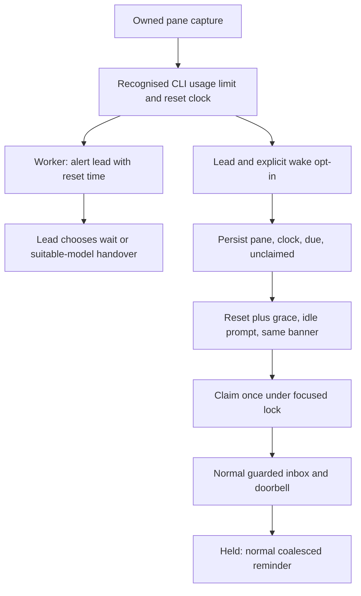

# Usage-limit recovery

`share/crew/limit.sh` implements the explicit lead-only wake policy used by
the watcher. Reset extraction lives in the shared `pane_observation` parser,
so classification and reset times use one window, gutter rule and error table. Detection/alerts already recognise Codex usage limits; waking
is off by default, including for lead.

```sh
crew up team --self lead --wake-on-limit rev=pi
crew -s team watch --ring --wake-on-limit   # existing crew, foreground
```

`up` stores the opt-in in its detached watch timer config. `watch` requires
`--ring`; stdout observation stays read-only. `up --no-watch` conflicts with
the flag; a crew without lead cannot enable it. Stopping the opted-in watcher
stops new wake attempts; already held inbox messages still follow normal
reminder delivery. Existing crews do not acquire the policy automatically.
A cancellation during a scan can still finish that scan's current delivery,
following the existing watcher contract.



The parser recognises an anchored `You’ve hit your usage limit.` (also ASCII
apostrophe/`You have`) and `try again at H:MM AM/PM`, including wrapped rows. Claude `You’ve hit your limit · resets 3pm`
(with optional minutes and `(Area/City)` or `(UTC)`) uses the same policy.
It ignores crew echoes and leaves unknown/missing/dated time formats manual.
Codex clocks use local time. Claude named timezones are honoured; clocks
without a timezone use local time. The next local
occurrence receives 60 seconds of grace; a scan after the due time can wake
lead. No service API confirms that credits have actually returned.

`limit-wake/lead` holds `pane|HH:MM [timezone]|due-epoch|claimed`, atomically replaced
under `.limit-wake.lock`. This persistent claim deduplicates concurrent or
restarted watchers. A changed pane/clock schedules a new occurrence; a clear
banner removes the record. Identical errors without an intervening clear
screen remain claimed: conservative suppression prevents daily retries of a
stale banner. Detection is based on rendered text and cannot prove that a
banner is the current error.

At dispatch the watcher rechecks ownership, the current banner and idle/busy
state using the shared observation patterns. Delivery pins the observed pane
so an override cannot wake a fresh successor. It claims before delivery, then
uses the existing `deliver`/`ring` guards and a nonblocking ring lock. Drafts,
dialogs, copy mode and role swaps remain protected. A held delivery is inbox
data and may later receive the normal coalesced reminder; no duplicate retry
message is added. A crash after claiming can lose the retry, intentionally
preferring at most one attempt. Shutdown/ended crews refuse scheduling.

Other CLIs/provider formats (including pi, bare HTTP 429s, relative delays and
unknown/dated reset strings) remain notification-only. The scheduling, claim
and delivery policy is shared; only the reset parser depends on the CLI.

Workers never auto-wake or change models. Their recognised reset time is part
of the normal debounced alert. Lead decides whether to wait or hand over
unfinished work, considering task/context requirements, replacement model
capabilities and available quota. Model and launch spec must be chosen
explicitly; board, inbox and override recovery context preserve the handover.

Verification lives in `test/limit.sh` (sourced by `test/smoke.sh`): exact
wrapped banner, 12-hour conversion, invalid/unknown formats, reset grace/day
rollover, flag contracts, persisted opt-in, one-shot claims across fresh
watchers, busy deferral, draft/dialog holds, stale ownership and shutdown.
Fixture captures stand in for agent CLIs; tests never spend or exhaust real quota.

Related: [watch.md](watch.md), [timers.md](timers.md),
[role-override.md](role-override.md), [messaging.md](messaging.md),
[../architecture/state-files.md](../architecture/state-files.md).
