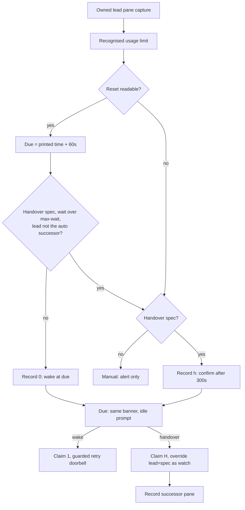

# Usage-limit recovery

`share/crew/limit.sh` implements the explicit lead-only policy used by the
watcher: wait and wake for a short reset, optionally hand over for a long one.
Reset extraction lives in the shared `pane_observation` parser, so
classification and reset times use one window, gutter rule and error table.
Detection/alerts already recognise Codex/Claude usage limits; waking and
handover are off by default, including for lead.

```sh
crew up team --self lead --wake-on-limit rev=pi
crew up team --self lead --handover-on-limit 'codex --model …' --max-wait 6h rev=pi
crew -s team watch --ring --wake-on-limit   # existing crew, foreground
```

`up` stores the opt-in (and the handover spec and max wait in seconds) in its
detached watch timer config. `watch` requires `--ring`; stdout observation
stays read-only. `up --no-watch` conflicts with the flags; a crew without lead
cannot enable them. `--handover-on-limit` implies `--wake-on-limit`;
`--max-wait` needs it. The spec must be a CLI command for a new pane: `%pane`,
`role=spec`, tabs and newlines are refused. Stopping the opted-in watcher
stops new attempts; already held inbox messages still follow normal reminder
delivery. Existing crews do not acquire the policy automatically.



## Reset parser

The error table anchors `You’ve hit your usage limit` (ASCII apostrophe,
`You have`, `for <model>`), Claude `You’ve hit your … limit`, and
`(weekly|5-hour|daily|session|opus|sonnet) limit reached`. The reset text is
whatever follows Codex `try again at` or Claude `resets`, joined across up to
six wrapped banner rows, with a trailing `(Area/City)`/`(UTC)` kept as the
zone. `when_value` accepts, in any order, exactly one clock (`3pm`, `3:30pm`,
`11:15 AM`), optionally a month name/abbreviation with a day (`Oct 31`,
`25th October`) and a 4-digit year, with `at`/`on`/commas as filler:

```text
try again at 11:15 AM                    -> 11:15
try again at 11:15 AM on October 25.     -> 10-25 11:15
try again at Oct 25th, 2026 11:15 AM.    -> 2026-10-25 11:15
resets Oct 31 at 3:30pm (Asia/Jakarta)   -> 10-31 15:30 Asia/Jakarta
resets in 3 days                         -> (no reset; still a provider limit)
```

Any unknown word rejects the whole reset. Crew echoes never count. Codex
clocks are local time; Claude named timezones are honoured.

## Due time

`limit_reset_due` turns `[[YYYY-]MM-DD ]HH:MM [zone]` into the reset minute
plus 60 seconds of grace. A bare clock is its next occurrence. A dated reset
is that day: a passed one is due now; without a year, a date over 180 days in
the past is next year (a January reset seen in late December). `limit_epoch`
round-trips the date, so impossible dates (`02-30`) stay manual. No service
API confirms that credits have actually returned.

## Wait or hand over

The decision is by wait length, not by the limit's name: a weekly reset may
also be hours away. With a handover spec, the watcher hands over when the
reset is unreadable or more than `--max-wait` (default 6h,
`limit_max_wait_default`) away; otherwise it waits and wakes. Without a spec,
an unreadable reset stays manual and a long one simply waits.

A handover is pending for `limit_handover_confirm` (300s) so a stale or
momentary banner never replaces a working lead. At dispatch the watcher
rechecks ownership, the current banner/reset and an idle prompt, claims `H`,
then runs the ordinary `cmd_override "lead=<spec>"` in a subshell with
`limit_handover_by=watch` (see [role-override.md](role-override.md)): spawn and
verify, save the old pane context, detach the old pane, notify every role.
The new lead pane is written to `limit-wake/successor`; a lead that is the
recorded successor never hands over again (no fallback chain), it waits for
its own reset. A manual override to another pane re-enables handover.
A failed handover is logged with the override's error and is not retried
for that banner. If the spec names an existing role at runtime, it is skipped.

## Claims

`limit-wake/lead` holds `pane|reset|due-epoch|state`, atomically replaced
under `.limit-wake.lock`; reset is the parsed value or `unknown`. States:
`0` wake scheduled, `1` woken, `h` handover pending, `H` handed over. This
persistent claim deduplicates concurrent or restarted watchers. A changed
pane/reset schedules a new occurrence; a cleared banner removes the record.
A reset that stops parsing for the same pane keeps the known record, so a
redraw can neither rearm a claim nor start a handover. Identical errors without
an intervening clear screen remain claimed: conservative suppression prevents
daily retries of a stale banner. Detection is based on rendered text and
cannot prove that a banner is the current error.

The wake path pins the observed pane so an override cannot wake a fresh
successor. It claims before delivery, then uses the existing `deliver`/`ring`
guards and a nonblocking ring lock. Drafts, dialogs, copy mode and role swaps
remain protected. A held delivery is inbox data and may later receive the
normal coalesced reminder; no duplicate retry message is added. A crash after
claiming can lose the retry or handover, intentionally preferring at most one
attempt. Shutdown/ended crews refuse scheduling.

## Workers

Workers never auto-wake, hand over or change models. Their recognised reset
time is part of the normal debounced alert. Lead decides whether to wait or
hand over unfinished work, considering task/context requirements, replacement
model capabilities and available quota. Model and launch spec are always
chosen explicitly (the lead's successor spec by the human, up front); board,
inbox and override recovery context preserve the handover.

## Verification

`test/limit.sh` (sourced by `test/smoke.sh`): wrapped/dated/yeared banners,
weekly wording, rejected words and dates, 12-hour conversion, grace, day and
year rollover, timezones, flag contracts, persisted opt-in and handover spec,
one-shot claims across fresh watchers, busy deferral, draft/dialog holds,
stale ownership, shutdown, short-weekly wait vs long-weekly handover, the
300s confirmation, a real spawned `cat` successor, no chained handover,
unknown resets with/without a spec, and the borrowed-identity refusal.
Fixture captures stand in for agent CLIs; tests never spend real quota.

Related: [watch.md](watch.md), [timers.md](timers.md),
[role-override.md](role-override.md), [messaging.md](messaging.md),
[../architecture/state-files.md](../architecture/state-files.md).
