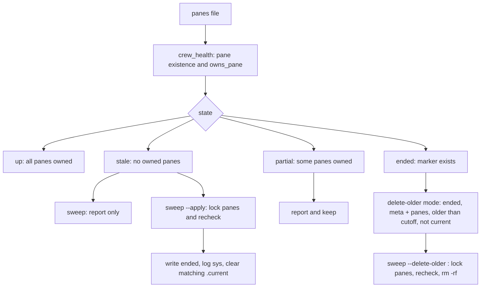

# Crew listing and stale cleanup

`crew ls` inspects every crew under `CREW_HOME`, independent of `-s` or the
calling pane. It never launches, types into, labels, unlabels or kills panes,
and does not detect models or scan tty processes.
`crew_health`, `age_text`, `last_epoch`, `human_size`, `prune_keep_reason`,
`cmd_ls`, `cmd_sweep` and `sweep_prune` live in `share/crew/listing.sh`,
sourced by `bin/crew` through `CREW_SHARE`. The module
uses the entrypoint's state, ownership and locking helpers; it adds no daemon
or independent entrypoint. The installed symlink resolves the checkout's
share directory in the same way as templates and the web viewer.

```sh
crew ls                              # all crews, ended crews last
crew ls --live                       # only up and partial crews
crew sweep                           # dry run; list stale crews and report partial crews
crew sweep --apply                   # end only stale crews; leave all panes alone
crew sweep --delete-older 14d        # dry run; list ended crew folders older than 14d
crew sweep --delete-older 14d --apply  # delete those folders and report freed space
```



## Listing contract

Columns: `CREW PROJECT STATE AGENTS TASKS LAST`. One aligned row per crew.

- `PROJECT` is `meta cwd`, with the home prefix shortened to `~`; cap at 48
  Unicode characters and append `…` when shortened. `truncate_text` uses
  Bash with a UTF-8 locale so BSD `column` never receives a cut UTF-8 sequence.
  Missing project values display `-`.
- `STATE` is `ended` if the marker exists, otherwise `up` if all recorded
  panes pass `owns_pane`, `partial` if some do, and `stale` if none do. An empty
  roster is stale. Missing pane ids count as gone, even when tmux returns
  success with empty output. Pane ownership checks include labels, not just
  the presence of a recycled id.
- `AGENTS` retains the full roster as `role=cli(alive|gone|reused)`. CLI names
  are shortened as in status. `alive` means an owned pane, not a responsive
  agent process; no process/model scraping is done. `gone` means the pane
  does not exist; `reused` means it exists but fails ownership.
- `TASKS` is `closed/total (N open)`: done and cancelled are closed. When
  cancellations exist, append `, X cancelled` inside the parentheses.
  An empty board is `0/0 (0 open)`.
- `LAST` is the age of the last `channel.log` timestamp (`5s`, `5m`, `3h`,
  `2d`) from `last_epoch`, parsed as local time because `now` writes local
  timestamps, then rendered by `age_text`. An empty or invalid timestamp
  displays `-`; future timestamps clamp to `0s`.
- Ended crews follow active crews. `--live` omits ended and stale rows.
  One directory pass collects active and ended row arrays; print active
  first, then ended. Guard empty arrays for Bash 3.2 with `set -u`.
  If stale crews exist, print `N stale crews: crew sweep --apply` after the
  table. There is no automatic cleanup during listing or any other command.

## Sweep contract

Default invocation only reports what would change; it does not acquire a
lock or alter state files. Partial crews are reported and never swept.
`--apply` takes each stale crew's `.panes.lock` and recomputes its health, so
an `add`, `rebind` or `override` that repairs it while sweep waits is respected.

Only a crew still classified stale gets an `ended` marker and a `sys` line;
clear `.current` only when it names that crew. Files, board, inboxes, results,
pane labels and panes remain intact. Ended crews are skipped on repeated
runs. The only writes are crew bookkeeping and the temporary lock directory.
Sweep does not call `down`, because `down` may unlabel or close panes.

## Prune contract (`--delete-older`)

Pruning is its own mode: `crew sweep --delete-older <age>` never marks stale
crews ended and plain `sweep --apply` never deletes a folder, so each run can
be reasoned about one way. Marking and pruning in one pass is not supported;
run both commands. `<age>` is an integer with an optional unit — `s`, `m`, `h`
or `d` — parsed by the shared `duration` helper in `bin/crew`, which also
serves timer delays and `watch --every`/`--quiet-after`. A zero or malformed
age is rejected here (the parser itself allows zero).

A folder qualifies only when all of these hold:

- it is a direct, non-symlink child of `CREW_HOME` holding both `meta` and
  `panes` (so `CREW_HOME/bin`, the web tmp dir and other non-crew directories
  are never listed or touched);
- it has the `ended` marker;
- the first field of its last `channel.log` line is older than the cutoff.
  A missing, empty or unparseable timestamp keeps it and says so;
- `CREW_HOME/.current` does not name it. The current crew is kept because
  many commands fall back to it even when its folder is ended.

`<name>.<YYYYMMDD-HHMMSS>` folders that `crew up` moves aside when a name is
reused keep `meta`, `panes` and `ended`, so they follow exactly these rules and
need no special case. The rules live in one `prune_keep_reason` function (dir +
cutoff → keep reason or nothing); the listing pass and the under-lock recheck
both call it, so they cannot drift apart.

Ended folders that do not qualify are still printed, with the reason: no last
activity, newer than the cutoff, or current crew. Non-crew directories are
never mentioned at all.

Without `--apply` nothing is written and each candidate prints
`<name>: ended, last activity <age> ago, <size>; would delete`, then a
`would free <size> from <N> folders (dry run: add --apply)` total. With
`--apply` each qualifying folder is re-checked under its own `.panes.lock`
(ended, timestamp and `.current` can all change while the command waits) with
the same `prune_keep_reason` qualification, its size is re-measured, and only
the exact `$CREW_HOME/<name>` path is removed
with `rm -rf`. The child name must be non-empty, contain no `/` and not be
`.`/`..`; nothing else is ever used to build a delete path. The lock directory
lives inside the pruned folder, so releasing it after `rm -rf` is a no-op.
Output is `<name>: …; deleted` per folder plus
`freed <size> from <N> folders`; a held lock stops the run with the usual
lock diagnostic, like the stale mode. Panes, labels and remaining folders are
never touched, and a run with nothing to delete prints
`nothing to prune: no ended crew older than <age>`.

Tests use fixture crews and detached scratch panes, comparing state-file and
pane-label snapshots around listing and dry-run sweep. Apply tests verify
up/partial crews survive and stale crews alone become ended. Prune tests build
ended fixtures with old, recent and missing timestamps, a live crew, the
current crew, an archived `<name>.<timestamp>` folder and a non-crew directory;
they check that the dry run deletes nothing, that `--apply` removes only the
qualifying folders (plus the freed-space total) and keeps everything else, that
a held `.panes.lock` blocks deletion, and that bad ages are rejected.

Related: [lifecycle.md](lifecycle.md), [messaging.md](messaging.md),
[../architecture/state-files.md](../architecture/state-files.md).
