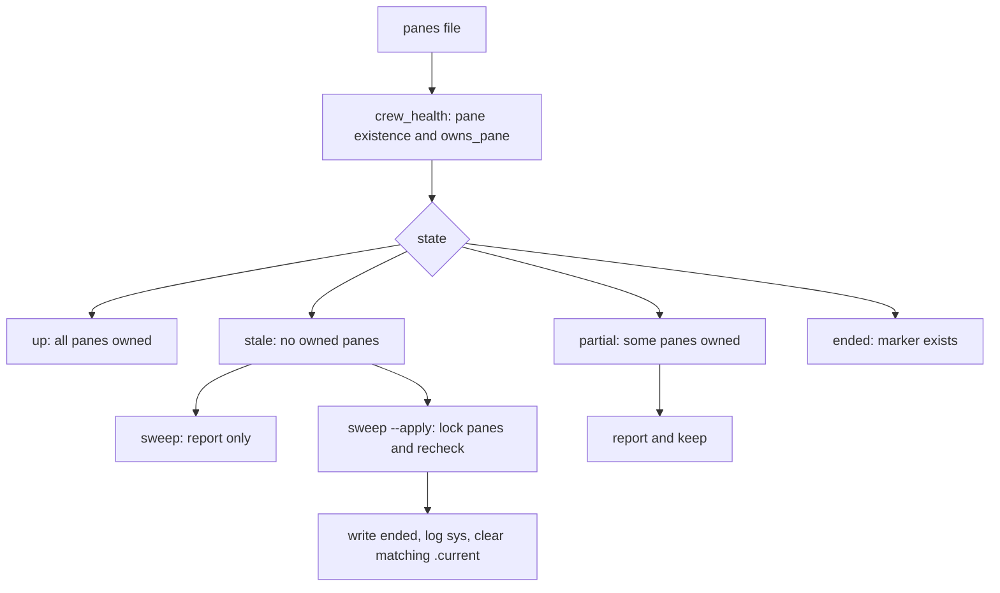

# Crew listing and stale cleanup

`crew ls` inspects every crew under `CREW_HOME`, independent of `-s` or the
calling pane. It never launches, types into, labels, unlabels or kills panes,
and does not detect models or scan tty processes.
`crew_health`, `relative_age`, `cmd_ls` and `cmd_sweep` live in
`share/crew/listing.sh`, sourced by `bin/crew` through `CREW_SHARE`. The module
uses the entrypoint's state, ownership and locking helpers; it adds no daemon
or independent entrypoint. The installed symlink resolves the checkout's
share directory in the same way as templates and the web viewer.

```sh
crew ls                 # all crews, ended crews last
crew ls --live          # only up and partial crews
crew sweep              # dry run; list stale crews and report partial crews
crew sweep --apply      # end only stale crews; leave all panes alone
```



## Listing contract

Columns: `CREW PROJECT STATE AGENTS TASKS LAST`. One aligned row per crew.

- `PROJECT` is `meta cwd`, with the home prefix shortened to `~`; cap at 48
  Unicode characters and append `…` when shortened. `truncate_text` uses
  Bash with a UTF-8 locale so BSD `column` never receives a cut UTF-8 sequence.
  Missing project values display `-`.
- `STATE` is `ended` if the marker exists, otherwise `up` if all recorded
  panes pass `owns_pane`, `partial` if some do, and `stale` if none do. An empty
  roster is stale. Missing pane ids count as gone, even when tmux returns
  success with empty output. Pane ownership checks include labels, not just
  the presence of a recycled id.
- `AGENTS` retains the full roster as `role=cli(alive|gone|reused)`. CLI names
  are shortened as in status. `alive` means an owned pane, not a responsive
  agent process; no process/model scraping is done. `gone` means the pane
  does not exist; `reused` means it exists but fails ownership.
- `TASKS` is `done/total (N open)`, counting every board row and treating
  statuses other than `done` as open. An empty board is `0/0 (0 open)`.
- `LAST` is the age of the last `channel.log` timestamp (`5s`, `5m`, `3h`,
  `2d`), parsed as local time because `now` writes local timestamps. An empty
  or invalid timestamp displays `-`; future timestamps clamp to `0s`.
- Ended crews follow active crews. `--live` omits ended and stale rows.
  One directory pass collects active and ended row arrays; print active
  first, then ended. Guard empty arrays for Bash 3.2 with `set -u`.
  If stale crews exist, print `N stale crews: crew sweep --apply` after the
  table. There is no automatic cleanup during listing or any other command.

## Sweep contract

Default invocation only reports what would change; it does not acquire a
lock or alter state files. Partial crews are reported and never swept.
`--apply` takes each stale crew's `.panes.lock` and recomputes its health, so
an `add`, `rebind` or `override` that repairs it while sweep waits is respected.

Only a crew still classified stale gets an `ended` marker and a `sys` line;
clear `.current` only when it names that crew. Files, board, inboxes, results,
pane labels and panes remain intact. Ended crews are skipped on repeated
runs. The only writes are crew bookkeeping and the temporary lock directory.
Sweep does not call `down`, because `down` may unlabel or close panes.

Tests use fixture crews and detached scratch panes, comparing state-file and
pane-label snapshots around listing and dry-run sweep. Apply tests verify
up/partial crews survive and stale crews alone become ended.

Related: [lifecycle.md](lifecycle.md), [messaging.md](messaging.md),
[../architecture/state-files.md](../architecture/state-files.md).
