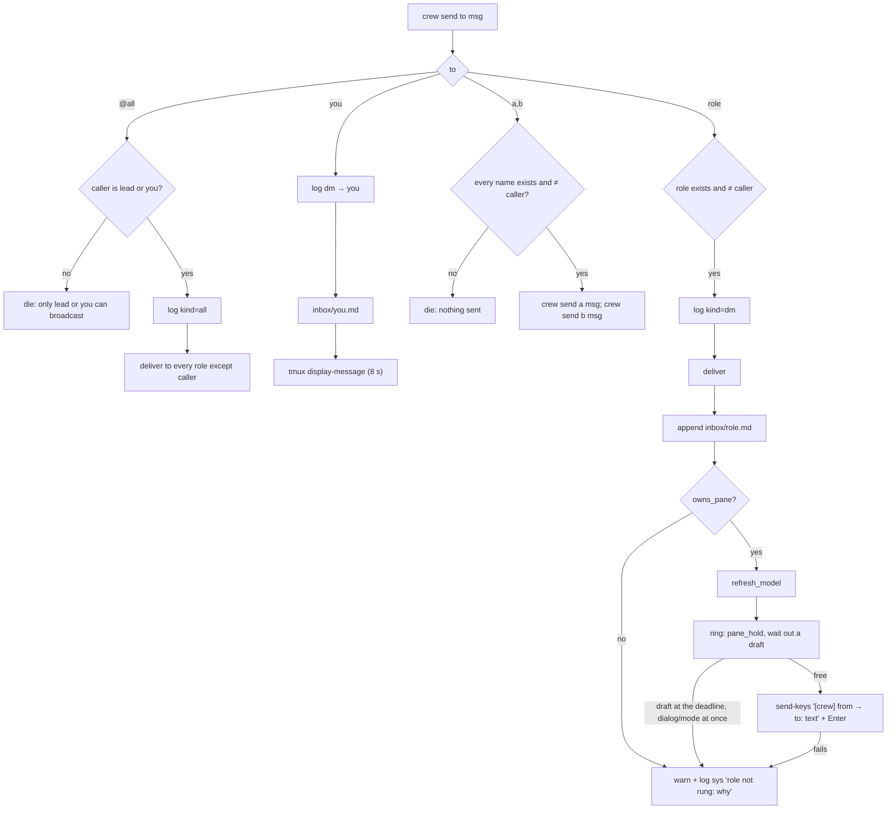
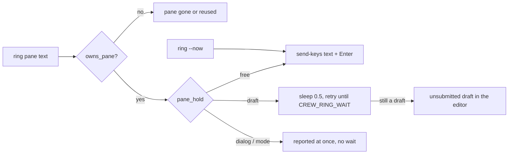
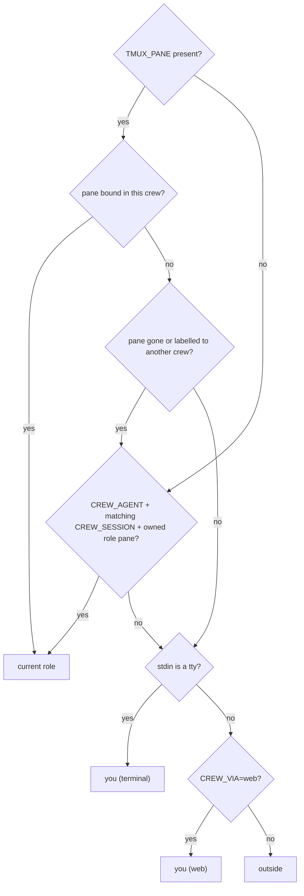

# Messaging: send, doorbell, ownership

## `crew send <to> <message…>`



- Delivery to the calling pane prints the notice on stdout. A startup dialog
  receives no typed input; the message stays in its inbox with a warning.
- The body goes to `inbox/<role>.md` in full (markdown heading per message).
  The inbox is the delivery; the doorbell is best-effort.
- A doorbell that isn't rung (pane gone/reused, showing a dialog or approval
  prompt, or `send-keys` failed) warns the sender on stderr and logs
  `sys <sender> <role> "<role> not rung: <why>; message is in inbox/<role>.md"`.
  So the timeline (`crew log`, web) answers "did impl ever get this?". crew
  does not retry: the sender (usually the lead) resends once the pane is free.
- Approval prompts are why `pane_hold` checks dialogs before anything else: a
  doorbell such as `T1 done` types a `1`, which picks option 1 ("Yes") in
  claude's and codex's approval selectors, before any Enter. Patterns and their
  sources: [lifecycle.md](lifecycle.md#readiness-heuristic). One home: `ring`
  returns the reason and `deliver` reports it. An agent that itself writes "Do
  you want to proceed?" near its prompt also holds doorbells; that errs on the
  safe side.
- `send a,b msg` checks every name first (nothing is sent if one is bad), then
  does one plain `send` per name: separate log lines, doorbells and inbox
  entries. `@all` can't be in a list.
- The doorbell is the message flattened to one line. Over `RING_MAX` (500)
  chars it becomes `long message; read the latest entry in …/inbox/<role>.md`.
- `ring` = hold (below), then `send-keys -l -- "$text"`, sleep 0.3, `send-keys
  Enter`, holding `$D/.ring<pane>.lock` (mkdir) throughout. Without the lock,
  parallel sends to one pane typed all texts into one prompt line and then N
  Enters (seen with 5 parallel `crew send`s). After 10 s of waiting the lock
  counts as left by a killed call and the ring goes ahead; the ring removes it
  either way. `ring --now` skips the hold and is used only by `start_agent`
  (a pane crew just created) and by `CREW_RING_WAIT=0`.
- `crew send you` has no pane: log + `inbox/you.md` + an 8-second tmux status
  message. Easy to miss; keep `crew log -f` or `crew web` open.
- The doorbell and inbox heading show `sender_label`: the role, `you (terminal)`,
  `you (web)`, or `outside %N (not in this crew)`.
- `crew say` = `send` that dies unless the caller resolves to `you`. It is the
  documented way for the human to give decisions.
- `crew note <text>` logs `sys: note (<caller>): text` (manual repairs, decisions).

## Ring hold: never type into a draft

`send-keys` types wherever the pane's cursor is. If the human left an
unsubmitted draft in the agent's editor, the doorbell is appended to it and
`ring`'s `Enter` submits the merge as one turn, so the draft is gone. `ring` is
safe by default: it holds first, and `ring --now` is the explicit exception
(`start_agent`, `CREW_RING_WAIT=0`). `share/crew/pane.sh` holds the readers,
`pane_hold`, `ring_hold` and `ring` (sourced like the listing module).



- `pane_hold <pane>` prints a `class<TAB>reason` record when the pane must not
  be typed into, nothing when it is safe. Order: the dialog grep →
  `#{pane_in_mode}` (non-empty and not `0`) → the editor table. The first two
  swallow keys before the editor sees them, and a claude dialog reuses `❯`
  (e.g. `❯ 1. Yes`), so they must come first: **dialogs and modes are checked
  for every pane**.
- The editor table is gated on `pane_cli` → `short_cli`: only claude, codex and
  pi are read, and an unknown pane is never held *for a draft* — a false hold
  makes an agent unringable, which is worse than the status quo; that same
  erring direction applies when the editor cannot be recognised at all.
- `ring` loops only while the class is `draft`; a dialog or mode returns at
  once, with its reason. `ring` prints the reason for `deliver`/`intro`, and one
  capture per poll serves both the dialog grep and the editor parser.

| CLI | editor is | idle | draft |
|---|---|---|---|
| claude | the bottom-most `❯` row | nothing after `❯` | any other text |
| codex | the bottom-most `›` row | nothing, or `Ask Codex to do anything…` (prefix match) | any other text |
| pi | a box drawn with `─` | its two border rows are found and the rows between them are empty | any non-empty row between them |

A pi border is either a dashes-only row of `#{pane_width} - 3` dashes or more,
or a row that is at least ~55 % dashes and carries a label
(`── ⠧ Working ──`); a mostly-dashes *draft* row (100 of 120 columns) is
neither, and the row holding the cursor can never be a border. pi is read
bottom-up, so transcript rows and queued `Steering:` lines above the box cannot
be mistaken for a draft. A renamed codex placeholder becomes a loud hold
(warning + `sys` line), not a silent merge.

- The wait is bounded by `CREW_RING_WAIT` (seconds, default `30`, capped at
  `3600`, polled twice a second). `0` turns the hold off (exactly the old
  behaviour); a value that is not digits (`0.5`, `-1`, `abc`, empty) falls back
  to `30`, and a leading zero is read as decimal (`08` = 8 s), never as bash
  octal — `$((08 * 2))` under `set -e` used to abort `crew send` after the
  inbox write, with no warning and no `sys … not rung` line. It reports `pane
  %N is gone or now belongs to something else`, `pane %N is showing a dialog or
  approval prompt`, `pane %N is in copy/choose mode` or `unsubmitted draft in
  the editor`.
- The waiting happens **before** `ring()` takes its mkdir lock, so a hold
  blocks neither another ring nor the 10 s stale-lock rule. The inbox write
  still comes first and `crew send` still exits 0, so a hold costs the
  doorbell, never the message, and the `sys … not rung: <why>` line names why.
- `crew web`'s child env carries `CREW_RING_WAIT=0`, so the viewer's HTTP
  request cannot block for 30 s. The transport is not consulted: `CREW_VIA=web`
  alone does not skip the hold.
- `intro` shares the hold (see [lifecycle.md](lifecycle.md)); with
  `CREW_RING_WAIT=0` every path behaves as before the hold existed.

## Ownership guard (`owns_pane`)

```sh
owns_pane() { # pane role
  local got
  got=$(tmux display-message -p -t "$1" '#{@crew_session}	#{@crew_role}' 2>/dev/null) || return 1
  [ "$got" = "$S	$2" ] || [ "$got" = "	$2" ]   # second form: crews labelled before @crew_session existed
}
```

Used before command launches and intros, for env identity fallback, by
`deliver`, `set_pane_status`, `status` (shows `STALE (pane reused)`), `down`
(skips the pane), and `ls`/`sweep` (classify liveness without touching panes).
Found in real use: after a tmux server restart an
old crew's lead id `%144` belonged to an unrelated Claude session, and
`status` looked healthy because both processes were named `2.1.284`.
Rings typed there would have become prompts in the wrong session.

The web viewer applies the same rule and shows the role as `stale`.

## Identity



Pane bindings take precedence over `CREW_AGENT` after overrides. A pane that
has been detached and left unlabelled cannot claim its previous identity via
stale environment variables. A matching `CREW_SESSION` / `CREW_AGENT` hint
is accepted only if that role's recorded pane passes `owns_pane`, and the
caller has no `TMUX_PANE`, its id is gone, or its pane is labelled to another
crew. This handles Codex tool shells inheriting a missing/foreign id from a
shared background process. Existing unlabelled or unbound same-crew panes
stay outside. Unknown roles, stale role panes and mismatched session hints
never get fallback identity. These remain advisory labels, not authentication.
`env_identity_ok` owns these early-return checks; `resolve_me` selects the
pane binding, then eligible env identity, then human/outside provenance.

`up` and spawning `add` both pass `CREW_SESSION` / `CREW_AGENT` to their new
panes. Adoption cannot modify an already-running agent's environment.

Agents' shell tools run without a tty (checked for Claude Code), so an agent
that isn't a crew member shows up as `outside`, not as the human. `outside`
cannot broadcast or `say`. This is **advisory provenance**: it stops honest
mistakes (a reused pane, an agent relaying "the user approved X"), not a
hostile process, which could fake a tty (`script`), set `CREW_VIA`, or write
the files directly. Consequences for the human: `! crew send …` typed into a
Claude Code prompt runs without a tty and is labelled `outside`; use a
terminal pane or `crew web --allow-send`.

`crew whoami` in a pane that isn't in the crew adds a stderr hint:
`pane %157 isn't in crew X; if an agent moved here: crew rebind <role>`.

## `crew log`

`fmt_log` prints `HH:MM:SS  from → to  text` (`· text` for sys lines).
`-f` follows (`tail -f`), `-n N` sets the backlog (default 40).

Related: [summary.md](summary.md), [tasks.md](tasks.md), [../roles/summary.md](../roles/summary.md).
