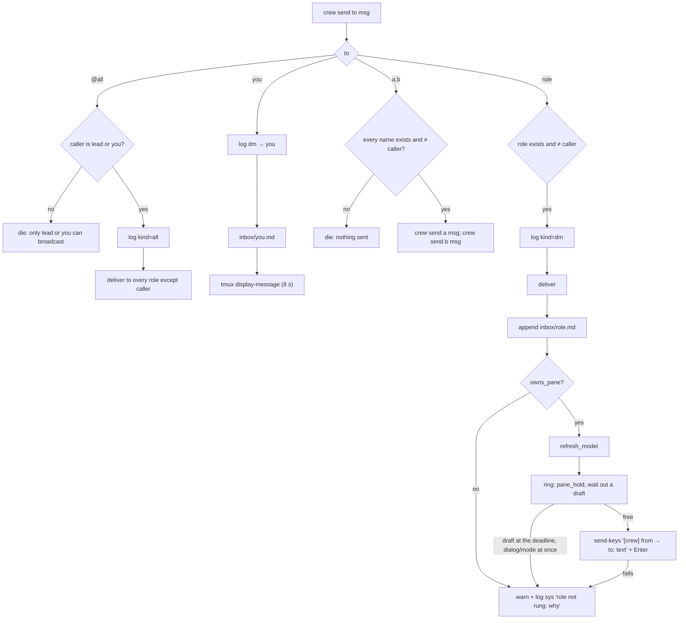
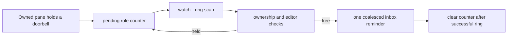
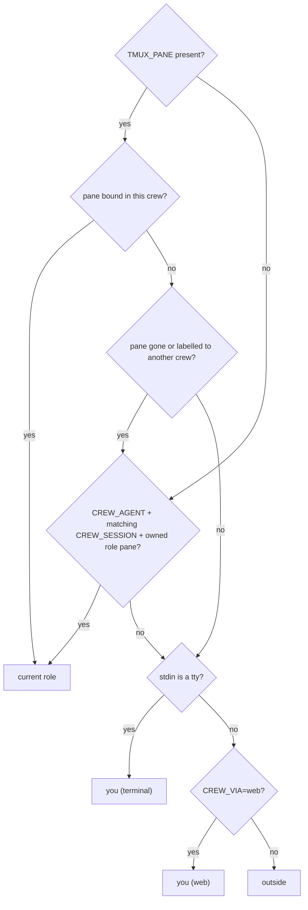

# Messaging: send, doorbell, ownership

## `crew send <to> <message…>`



- Delivery to the calling pane prints the notice on stdout. A startup dialog
  receives no typed input; the message stays in its inbox with a warning.
- The body goes to `inbox/<role>.md` in full (markdown heading per message).
  The inbox is the delivery; the doorbell is best-effort.
- A doorbell that isn't rung (pane gone/reused, showing a dialog or approval
  prompt, or `send-keys` failed) warns the sender on stderr and logs
  `sys <sender> <role> "<role> not rung: <why>; message is in inbox/<role>.md"`.
  The timeline (`crew log`, web) records the hold. An owned-pane delivery also
  records a pending reminder; a ringing watcher retries it after the editor clears.
  Messages to missing/reused panes stay in the inbox without a pending reminder.
- Approval prompts are why `pane_hold` checks dialogs before anything else: a
  doorbell such as `T1 done` types a `1`, which picks option 1 ("Yes") in
  claude's and codex's approval selectors, before any Enter. Patterns and their
  sources: [lifecycle.md](lifecycle.md#readiness-heuristic). One home: `ring`
  returns the reason and `deliver` reports it. An agent that itself writes "Do
  you want to proceed?" near its prompt also holds doorbells; that errs on the
  safe side.
- `send a,b msg` checks every name first (nothing is sent if one is bad), then
  does one plain `send` per name: separate log lines, doorbells and inbox
  entries. `@all` can't be in a list.
- The doorbell is the message flattened to one line. Over `RING_MAX` (500)
  chars it becomes `long message; see: crew inbox --last` — a pointer into the
  recipient's inbox, not the text.
- `ring` = hold (below), then `send-keys -l -- "$text"`, sleep 0.3, `send-keys
  Enter`, holding `$D/.ring<pane>.lock` (mkdir) throughout. Without the lock,
  parallel sends to one pane typed all texts into one prompt line and then N
  Enters (seen with 5 parallel `crew send`s). After 10 s of waiting the lock
  counts as left by a killed call and the ring goes ahead; the ring removes it
  either way. `ring --now` skips the hold and is used only by `start_agent`
  (a pane crew just created). `CREW_RING_WAIT=0` still checks the pane once.
- Timer delivery uses an internal `RING_TRY_LOCK=1` mode: an existing pane
  ring lock causes immediate refusal with inbox retention. It never bypasses
  the lock or draft/dialog holds. Ordinary sends keep the 10-second behavior
  above. Per-timer dispatch locks coordinate cancellation outside the shared
  timer metadata lock; see [timers.md](timers.md).
- `crew send you` has no pane: log + `inbox/you.md` + an 8-second tmux status
  message. Easy to miss; keep `crew log -f` or `crew web` open.
- The doorbell and inbox heading show `sender_label`: the role, `you (terminal)`,
  `you (web)`, or `outside %N (not in this crew)`.
- `crew say <role[,role…]|@all> <message>` = `send` that dies unless the caller
  resolves to `you`. Missing arguments print `say` usage. An agent caller gets
  a hint to use a terminal outside crew panes or `crew -s <name> web --allow-send`;
  a Claude Code `!` command still runs in the agent pane.
  Example: `crew -s demo say lead "Proceed with the agreed scope"`.
  Decisions given in lead's own human conversation need no repeat via `say`;
  see [../roles/summary.md](../roles/summary.md#lead-as-the-humans-coordination-point).
- `crew note <text>` logs `sys: note (<caller>): text` (manual repairs, decisions).

## Held doorbell reminders

`deliver` appends the inbox entry once, then records held deliveries in
`pending/<role>` as a decimal count. Reminders follow that role's inbox across
rebinds and takeovers, targeting only its current owned pane. A successful inline message leaves older
pending deliveries for an explicit reminder; it does not assume the recipient
read the whole inbox. Only `watch --ring` replays, including the watcher `up`
starts. Without one, held messages remain pending until a ringing watcher runs.

Each scan retries through `owns_pane`, the normal dialog/draft/mode hold and a
nonblocking ring lock. One reminder says `N new messages — crew inbox <role>`;
it adds no inbox entry. A per-role pending lock serializes increments and replay;
the counter is cleared only after success. Stdout watch leaves pending state
alone. A held replay retains the counter for a later scan. These are best-effort
notifications: a crash can retain a sent reminder or miss an increment; inbox
contents remain authoritative. Pending locks are never stolen; inspect a stale
holder before removing `pending/.<role>.lock` manually.



## Ring hold: never type into a draft

Draft, dialog, mode and parser checks are shared by ordinary and replayed
doorbells. See [ring-hold.md](ring-hold.md) for the parser and wait contract.

## Ownership guard (`owns_pane`)

```sh
owns_pane() { # pane role
  local got
  got=$(tmux display-message -p -t "$1" '#{@crew_session}	#{@crew_role}' 2>/dev/null) || return 1
  [ "$got" = "$S	$2" ] || [ "$got" = "	$2" ]   # second form: crews labelled before @crew_session existed
}
```

Used before command launches and intros, for env identity fallback, by
`deliver`, `set_pane_status`, `status` (shows `STALE (pane reused)`), `down`
(skips the pane), and `ls`/`sweep` (classify liveness without touching panes).
Found in real use: after a tmux server restart an
old crew's lead id `%144` belonged to an unrelated Claude session, and
`status` looked healthy because both processes were named `2.1.284`.
Rings typed there would have become prompts in the wrong session.

The web viewer applies the same rule and shows the role as `stale`.

## Identity



Pane bindings take precedence over `CREW_AGENT` after overrides. A pane that
has been detached and left unlabelled cannot claim its previous identity via
stale environment variables. A matching `CREW_SESSION` / `CREW_AGENT` hint
is accepted only if that role's recorded pane passes `owns_pane`, and the
caller has no `TMUX_PANE`, its id is gone, or its pane is labelled to another
crew. This handles Codex tool shells inheriting a missing/foreign id from a
shared background process. Existing unlabelled or unbound same-crew panes
stay outside. Unknown roles, stale role panes and mismatched session hints
never get fallback identity. These remain advisory labels, not authentication. Rendered role files explain
per-call `CREW_SESSION` / `CREW_AGENT` hints for tool shells inheriting a dead or
foreign pane, verified with `whoami`; shell-wide exports may not persist across
Codex tool calls. Unresolved `task set` fails before any gate or board write,
including `--force`, and names the failed check plus the recovery command.
`env_identity_ok` owns these early-return checks; `resolve_me` selects the
pane binding, then eligible env identity, then human/outside provenance.

`crew whoami` prints the deciding check as a `why: …` line, e.g. `pane %5
is bound to impl`, `env CREW_AGENT=impl, CREW_SESSION=t; TMUX_PANE %999999
not found`, or `TMUX_PANE %13 is unlabelled`. Refusals name the first failed
check: no `CREW_AGENT`, a mismatched `CREW_SESSION`, no pane bound to the
role, the role's pane gone or relabelled, the pane unlabelled, or the pane
labelled to this crew but bound to no role. A `crew send` that resolves as
`outside` writes the same reason plus the `crew whoami` hint to stderr (once
per invocation, before recipient checks); the doorbell label stays
`outside %N (not in this crew)`.

`up` and spawning `add` both pass `CREW_SESSION` / `CREW_AGENT` to their new
panes. Adoption cannot modify an already-running agent's environment.

Agents' shell tools run without a tty (checked for Claude Code), so an agent
that isn't a crew member shows up as `outside`, not as the human. `outside`
cannot broadcast or `say`. This is **advisory provenance**: it stops honest
mistakes (a reused pane, an agent relaying "the user approved X"), not a
hostile process, which could fake a tty (`script`), set `CREW_VIA`, or write
the files directly. Consequences for the human: `! crew send …` typed into a
Claude Code prompt runs without a tty and is labelled `outside`; use a
terminal pane or `crew web --allow-send`.

`crew whoami` in a pane that isn't in the crew adds a stderr hint:
`pane %157 isn't in crew X; if an agent moved here: crew rebind <role>`.

## `crew log`

`fmt_log` prints `HH:MM:SS  from → to  text` (`· text` for sys lines).
`-f` follows (`tail -f`), `-n N` sets the backlog (default 40).

## `crew inbox`

`crew inbox [role] [--last [N]] [--from <role>] [--since HH:MM]` prints whole
delivery entries from `inbox/<role>.md` — the long-message doorbell above is
just a pointer to it. Read-only: no ring, no pane access.

- The role defaults to the caller's own role; `you` and `outside` default to
  `lead`. An unknown role dies; an empty or filtered-out result prints
  `(no messages)`. `crew inbox you` reads the human's `inbox/you.md`.
- `--last [N]` keeps the newest N entries (no N = 1; a non-integer or zero
  count dies), `--from <role>` matches the heading's sender exactly or as
  `role (…)` (so `--from you` covers terminal and web), `--since HH:MM` keeps
  entries at or after that time.
- Entry boundaries are only lines matching the header the writer emits,
  `## <ISO timestamp>  <sender> → <to>` (timestamp pattern plus the arrow), so
  an H2 like `## Findings` inside a message body never splits an entry: the
  body is kept and printed whole.

Related: [summary.md](summary.md), [tasks.md](tasks.md), [../roles/summary.md](../roles/summary.md).
