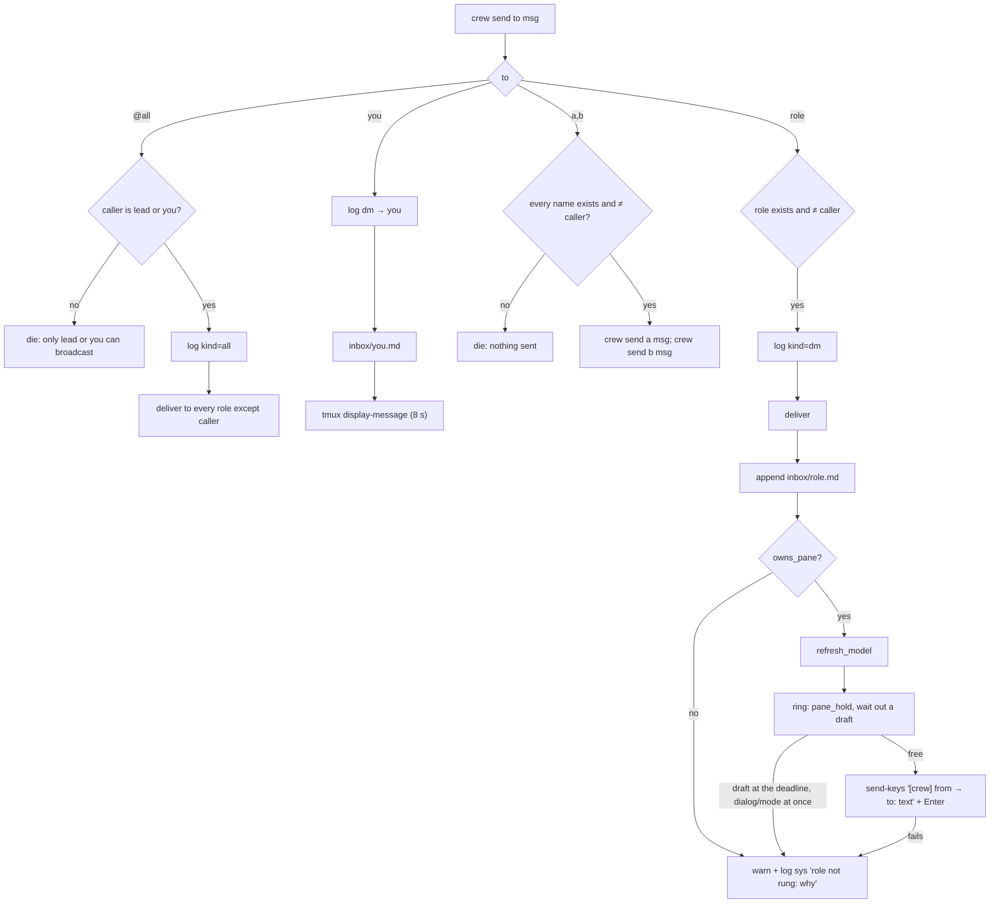
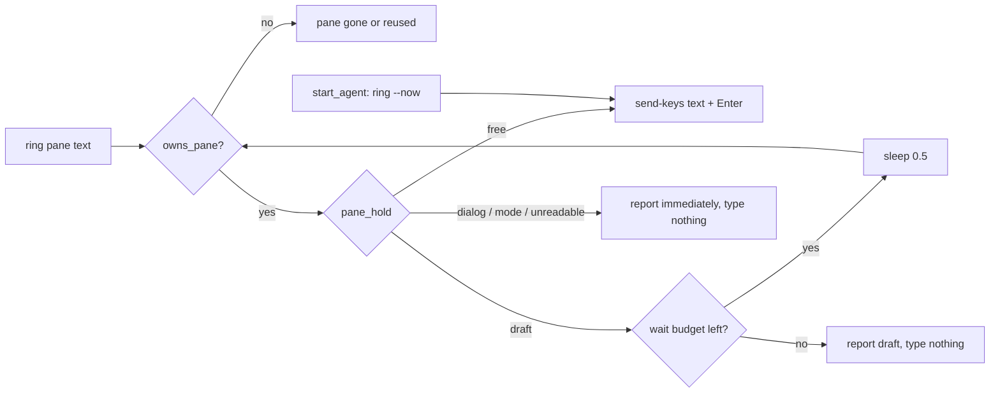
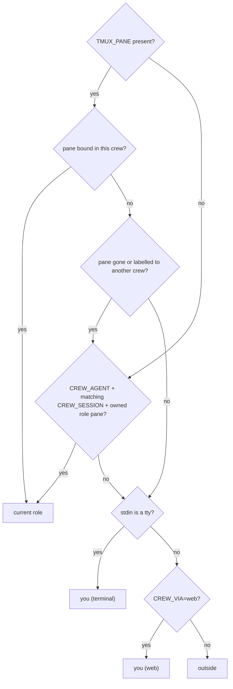

# Messaging: send, doorbell, ownership

## `crew send <to> <message…>`



- Delivery to the calling pane prints the notice on stdout. A startup dialog
  receives no typed input; the message stays in its inbox with a warning.
- The body goes to `inbox/<role>.md` in full (markdown heading per message).
  The inbox is the delivery; the doorbell is best-effort.
- A doorbell that isn't rung (pane gone/reused, showing a dialog or approval
  prompt, or `send-keys` failed) warns the sender on stderr and logs
  `sys <sender> <role> "<role> not rung: <why>; message is in inbox/<role>.md"`.
  So the timeline (`crew log`, web) answers "did impl ever get this?". crew
  does not retry: the sender (usually the lead) resends once the pane is free.
- Approval prompts are why `pane_hold` checks dialogs before anything else: a
  doorbell such as `T1 done` types a `1`, which picks option 1 ("Yes") in
  claude's and codex's approval selectors, before any Enter. Patterns and their
  sources: [lifecycle.md](lifecycle.md#readiness-heuristic). One home: `ring`
  returns the reason and `deliver` reports it. An agent that itself writes "Do
  you want to proceed?" near its prompt also holds doorbells; that errs on the
  safe side.
- `send a,b msg` checks every name first (nothing is sent if one is bad), then
  does one plain `send` per name: separate log lines, doorbells and inbox
  entries. `@all` can't be in a list.
- The doorbell is the message flattened to one line. Over `RING_MAX` (500)
  chars it becomes `long message; see: crew inbox --last` — a pointer into the
  recipient's inbox, not the text.
- `ring` = hold (below), then `send-keys -l -- "$text"`, sleep 0.3, `send-keys
  Enter`, holding `$D/.ring<pane>.lock` (mkdir) throughout. Without the lock,
  parallel sends to one pane typed all texts into one prompt line and then N
  Enters (seen with 5 parallel `crew send`s). After 10 s of waiting the lock
  counts as left by a killed call and the ring goes ahead; the ring removes it
  either way. `ring --now` skips the hold and is used only by `start_agent`
  (a pane crew just created). `CREW_RING_WAIT=0` still checks the pane once.
- Timer delivery uses an internal `RING_TRY_LOCK=1` mode: an existing pane
  ring lock causes immediate refusal with inbox retention. It never bypasses
  the lock or draft/dialog holds. Ordinary sends keep the 10-second behavior
  above. Per-timer dispatch locks coordinate cancellation outside the shared
  timer metadata lock; see [timers.md](timers.md).
- `crew send you` has no pane: log + `inbox/you.md` + an 8-second tmux status
  message. Easy to miss; keep `crew log -f` or `crew web` open.
- The doorbell and inbox heading show `sender_label`: the role, `you (terminal)`,
  `you (web)`, or `outside %N (not in this crew)`.
- `crew say` = `send` that dies unless the caller resolves to `you`. It is the
  documented way for the human to give decisions.
- `crew note <text>` logs `sys: note (<caller>): text` (manual repairs, decisions).

## Ring hold: never type into a draft

`send-keys` types wherever the pane's cursor is. If the human left an
unsubmitted draft in the agent's editor, the doorbell appends to it and
`ring`'s `Enter` submits the merge as one turn. Normal `ring` inspects the pane
first; only `start_agent` uses `ring --now` for a pane crew just created.
`share/crew/pane.sh` holds the readers, `pane_hold`, `ring_hold` and `ring`,
sourced like the listing module. `CREW_RING_WAIT=0` means **no waiting, not no
protection**: inspect once and refuse any recognised non-free state immediately.



- `pane_hold <pane>` always exits 0, printing `class<TAB>reason` when it must
  refuse input and nothing when it finds no hold. Order: dialog UI rows →
  `#{pane_in_mode}` (non-empty and not `0`) → the editor table. Dialogs and
  modes swallow keys before the editor sees them, and a claude dialog reuses
  `❯` (e.g. `❯ 1. Yes`), so these checks apply to every CLI first.
- The editor table is gated on `pane_cli` → `short_cli`: only claude, codex and
  pi are read. Unknown CLIs or unrecognised editor renderings do not cause a
  draft hold. A renamed codex placeholder becomes a loud draft hold instead.
- A recogniser that exits nonzero returns `unreadable` with `could not read the
  <cli> editor`, not an empty result. A crashed parser is not evidence of an
  empty editor. This refusal is immediate, including at zero wait, and uses
  the same sender warning and `sys … not rung` log as other refusals.
- Only `draft` is retried; `dialog`, `mode`, and `unreadable` return at once.
  One capture per poll serves both dialog detection and the editor parser.
  Dialog row matching and its observed sources are described in
  [lifecycle.md](lifecycle.md#readiness-heuristic).

| CLI | editor is | idle | draft |
|---|---|---|---|
| claude | the bottom-most `❯` row | nothing after `❯` | any other text |
| codex | the bottom-most `›` row | nothing, or `Ask Codex to do anything…` (prefix match) | any other text |
| pi | a box drawn with `─` | its two border rows are found and the rows between them are empty | any non-empty row between them |

A pi border is either a dashes-only row of `#{pane_width} - 3` dashes or more,
or a row below that threshold with at least 55 % dashes and a label
(`── ⠧ Working ──`). A 100-of-120-dash draft row is neither, and the cursor
row cannot be a border. The parser uses `LC_ALL=C`: `─` is three UTF-8 bytes;
separate dash and whitespace substitutions avoid macOS awk's multibyte bracket
class failure on braille spinners. Reading bottom-up keeps queued `Steering:`
rows above the editor out of the box.

**Residual limit:** Pi drafts containing a full-width or border-like dashed row
can be mistaken for an empty editor when the cursor is elsewhere or unavailable,
allowing a doorbell to append to and submit that draft. Choosing an earlier
border instead can consume legitimate transcript rules, so no additional
untested border heuristic is applied. Smoke pins the known limitation.

Rendered text is a heuristic, not the editor buffer. Hidden or unrecognised
editors can escape detection, and the human can type between inspection and
injection (that interval can include waiting for the ring lock). The hold
reduces draft merges; it does not provide an atomic guarantee against them.

- `CREW_RING_WAIT` is a wait budget in seconds, default `30`, capped at `3600`,
  with half-second sleeps between checks. `0` does one check and refuses a
  busy pane without sleeping. Invalid values (`0.5`, `-1`, `abc`, empty) use
  `30`. Leading zeros are stripped before decimal conversion and clamping:
  `08` = 8 seconds, `000030` = 30, `00000` = 0. Capture/process time is additional
  to the sleep budget; the default allows 60 half-second sleeps.
- Waiting happens **before** the mkdir ring lock, so it holds neither another
  ring nor the 10-second stale-lock timer. The inbox write still comes first
  and `crew send` exits 0 on a refused ring. The sender gets a warning and a
  `sys … not rung: <why>` line; the message remains in the inbox for a resend
  once the editor is free.
- `crew web` gives its child `CREW_RING_WAIT=0`: it checks once and refuses a
  draft immediately instead of blocking the HTTP request or submitting it.
  `CREW_VIA=web` alone is a sender label, not a hold bypass.
- `intro` shares this policy ([lifecycle.md](lifecycle.md)); zero wait also
  refuses an intro when the pane holds a draft.

## Ownership guard (`owns_pane`)

```sh
owns_pane() { # pane role
  local got
  got=$(tmux display-message -p -t "$1" '#{@crew_session}	#{@crew_role}' 2>/dev/null) || return 1
  [ "$got" = "$S	$2" ] || [ "$got" = "	$2" ]   # second form: crews labelled before @crew_session existed
}
```

Used before command launches and intros, for env identity fallback, by
`deliver`, `set_pane_status`, `status` (shows `STALE (pane reused)`), `down`
(skips the pane), and `ls`/`sweep` (classify liveness without touching panes).
Found in real use: after a tmux server restart an
old crew's lead id `%144` belonged to an unrelated Claude session, and
`status` looked healthy because both processes were named `2.1.284`.
Rings typed there would have become prompts in the wrong session.

The web viewer applies the same rule and shows the role as `stale`.

## Identity



Pane bindings take precedence over `CREW_AGENT` after overrides. A pane that
has been detached and left unlabelled cannot claim its previous identity via
stale environment variables. A matching `CREW_SESSION` / `CREW_AGENT` hint
is accepted only if that role's recorded pane passes `owns_pane`, and the
caller has no `TMUX_PANE`, its id is gone, or its pane is labelled to another
crew. This handles Codex tool shells inheriting a missing/foreign id from a
shared background process. Existing unlabelled or unbound same-crew panes
stay outside. Unknown roles, stale role panes and mismatched session hints
never get fallback identity. These remain advisory labels, not authentication.
`env_identity_ok` owns these early-return checks; `resolve_me` selects the
pane binding, then eligible env identity, then human/outside provenance.

`up` and spawning `add` both pass `CREW_SESSION` / `CREW_AGENT` to their new
panes. Adoption cannot modify an already-running agent's environment.

Agents' shell tools run without a tty (checked for Claude Code), so an agent
that isn't a crew member shows up as `outside`, not as the human. `outside`
cannot broadcast or `say`. This is **advisory provenance**: it stops honest
mistakes (a reused pane, an agent relaying "the user approved X"), not a
hostile process, which could fake a tty (`script`), set `CREW_VIA`, or write
the files directly. Consequences for the human: `! crew send …` typed into a
Claude Code prompt runs without a tty and is labelled `outside`; use a
terminal pane or `crew web --allow-send`.

`crew whoami` in a pane that isn't in the crew adds a stderr hint:
`pane %157 isn't in crew X; if an agent moved here: crew rebind <role>`.

## `crew log`

`fmt_log` prints `HH:MM:SS  from → to  text` (`· text` for sys lines).
`-f` follows (`tail -f`), `-n N` sets the backlog (default 40).

## `crew inbox`

`crew inbox [role] [--last [N]] [--from <role>] [--since HH:MM]` prints whole
delivery entries from `inbox/<role>.md` — the long-message doorbell above is
just a pointer to it. Read-only: no ring, no pane access.

- The role defaults to the caller's own role; `you` and `outside` default to
  `lead`. An unknown role dies; an empty or filtered-out result prints
  `(no messages)`. `crew inbox you` reads the human's `inbox/you.md`.
- `--last [N]` keeps the newest N entries (no N = 1; a non-integer or zero
  count dies), `--from <role>` matches the heading's sender exactly or as
  `role (…)` (so `--from you` covers terminal and web), `--since HH:MM` keeps
  entries at or after that time.
- Entry boundaries are only lines matching the header the writer emits,
  `## <ISO timestamp>  <sender> → <to>` (timestamp pattern plus the arrow), so
  an H2 like `## Findings` inside a message body never splits an entry: the
  body is kept and printed whole.

Related: [summary.md](summary.md), [tasks.md](tasks.md), [../roles/summary.md](../roles/summary.md).
