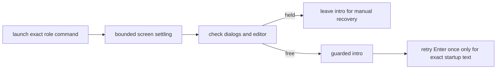

# Readiness heuristic

`wait_ready` is a guess: spinners or clocks in a TUI can keep the screen
changing until the timeout. Claude and Codex queue input typed during a turn;
pi was not checked.

A startup dialog also "settles", and Enter picks its highlighted choice
(seen 2026-09-30, tmux 3.5a):

| CLI | dialog | highlighted choice |
|-----|--------|--------------------|
| claude | folder trust, footer `Enter to confirm · Esc to cancel` | `❯ No, exit` |
| codex | update, footer `enter continue · esc skip` | `› 1. Update now` (`brew upgrade`) |
| codex | folder trust, `Trust this folder?`, `enter continue · esc back` | `› 1. Trust and continue` |

A command that fails also "settles". The spec is typed into the user's shell,
so a shell error such as zsh's `no matches found` for an unquoted `[...]` in a
codex `-c` value (seen 2026-09-30) leaves the pane at a prompt. The intro would
then run as a shell command too. So `up` checks `detect_cli` after
`wait_ready`: no non-shell process means the agent isn't running. This check is
used for spawned agents in `up` and `add`; adoption may take a pane the human
runs a shell in. A live pane always lists at least its shell, so an empty `ps`
list means ps itself is blocked (a sandboxed caller, seen 2026-10-21 inside a
Codex workspace sandbox), not a failed command: crew says so and sends the
intro anyway.

Mid-session approval prompts are the same hazard for every doorbell (see
[messaging.md](messaging.md)); their text, from the CLI binaries (claude
2.1.285, codex 0.159.0): claude "Do you want to proceed?", codex "Would you
like to run the following command?" / "make the following edits" / "grant
these permissions" / "send input…", both "Yes, and don't ask again …".

`in_dialog` feeds the capture to `dialog_capture` in `share/crew/pane.sh`.
It trims leading whitespace and UI gutters (`│`, `›`, `❯`), then matches a UI
row from its start, case-insensitively. Footer hints (`enter [to]
confirm|continue|select … esc [to] back|cancel|skip`) must end at the end of the
row and occur in the last **3 nonblank rows**. Approval/trust questions and
“don't ask again” option rows use the last **15 nonblank rows**: a claude
question can sit above a variable-height option list without an enter footer.
Codex's model picker (`enter select · esc back`) is classified as a dialog.
Anchoring avoids mid-sentence transcript quotations; a transcript quoting an
exact standalone UI row can still cause a conservative false hold.
`intro()` itself checks, so `up`, `add`, `adopt` and `rebind --intro` are all
covered: on a match it types nothing and prints the `crew send` line that
delivers the intro once the human has answered. crew never answers a dialog itself:
that would be trusting a folder or updating on the user's behalf. A per-CLI
"ready prompt" regex was rejected: claude's dialog uses the same `❯` as its
prompt. `--self` never types an intro (it prints one on stdout).

`intro` also goes through the ring hold to avoid appending to a recognised
draft in an adopted or rebound pane: it waits for the editor to clear
(bounded by `CREW_RING_WAIT`), then prints the same `crew send` line if it
remains held ([messaging.md](messaging.md#ring-hold-never-type-into-a-draft)).
`start_agent` uses `ring --now`: it types into a pane crew just created. With
`CREW_RING_WAIT=0` intros inspect once and refuse a busy pane immediately.

A CLI still starting can swallow ring's Enter, leaving crew's intro as a
draft that then holds every later doorbell (pi did this for hours in
`ringrace`). After a typed intro, `intro_submit` waits (~3 s, bounded), and if
the editor still holds a draft it presses Enter once more — but only when
`draft_text` shows the editor holds exactly the line crew typed. Codex composer
continuation rows are reconstructed even when they are hard-wrapped by the UI
and tmux `capture-pane -J` cannot join them. Extra text is retained for the exact
comparison; a matching prefix alone never permits submission. Thus no other
draft is ever submitted. Still a draft after that prints a warning with the
`tmux send-keys -t %P Enter` hint; there is no loop. `crew status`/`crew watch`
flag the state as `draft pending: doorbells are held` ([watch.md](watch.md)).

Related: [lifecycle.md](lifecycle.md), [ring-hold.md](ring-hold.md), [watch.md](watch.md).
