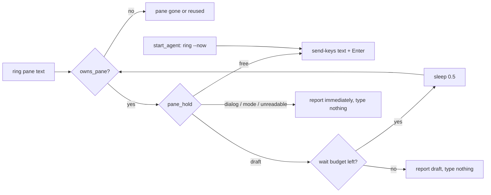

# Ring hold: never type into a draft

`send-keys` types wherever the pane's cursor is. If the human left an
unsubmitted draft in the agent's editor, the doorbell appends to it and
`ring`'s `Enter` submits the merge as one turn. Normal `ring` inspects the pane
first; only `start_agent` uses `ring --now` for a pane crew just created.
`share/crew/pane.sh` holds the readers, `pane_hold`, `ring_hold` and `ring`,
sourced like the listing module. `CREW_RING_WAIT=0` means **no waiting, not no
protection**: inspect once and refuse any recognised non-free state immediately.

- `pane_hold <pane>` always exits 0, printing `class<TAB>reason` when it must
  refuse input and nothing when it finds no hold. Order: dialog UI rows →
  `#{pane_in_mode}` (non-empty and not `0`) → the editor table. Dialogs and
  modes swallow keys before the editor sees them, and a claude dialog reuses
  `❯` (e.g. `❯ 1. Yes`), so these checks apply to every CLI first.
- The editor table is gated on `pane_cli` → `short_cli`: only claude, codex, pi and
  command-code are read. Unknown CLIs or unrecognised editor renderings do not cause a
  draft hold. A renamed codex placeholder becomes a loud draft hold instead.
  The unknown-CLI branch drains stdin without printing text: returning before
  its producer finishes can make `printf` fail with SIGPIPE under `pipefail`,
  falsely turning an unsupported editor (including smoke's `cat`) into an
  `unreadable` hold. `test/ui.sh` pins this with a large input stream.
- A recogniser that exits nonzero returns `unreadable` with `could not read the
  <cli> editor`, not an empty result. A crashed parser is not evidence of an
  empty editor. This refusal is immediate, including at zero wait, and uses
  the same sender warning and `sys … not rung` log as other refusals.
- Only `draft` is retried; `dialog`, `mode`, and `unreadable` return at once.
  One capture per poll serves both dialog detection and the editor parser.
  Dialog row matching and its observed sources are described in
  [lifecycle.md](lifecycle.md#readiness-heuristic).

| CLI | editor is | idle | draft |
|---|---|---|---|
| claude | the bottom-most `❯` row | blank text or a standalone dim span | any other text |
| codex | the bottom-most `›` row and its indented continuation rows | nothing, or `Ask Codex to do anything…` (prefix match) | any other text |
| command-code | the bottom-most `❯` row (process title `command-code`, run via node) | blank, or `Ask your question` (prefix match) | any other text |
| pi | a box drawn with `─` | its two border rows are found and the rows between them are empty | any non-empty row between them |

Claude captures retain SGR styling so its standalone dim ghost span can be
removed whatever wording Claude generates. Text outside that span, including
text after an SGR reset, remains a draft. Dialog and status observation
matching strip SGR before checking their UI rows.

A pi border is either a dashes-only row of `#{pane_width} - 3` dashes or more,
or a row below that threshold with at least 55 % dashes and a label
(`── ⠧ Working ──`). A 100-of-120-dash draft row is neither, and the cursor
row cannot be a border. The parser uses `LC_ALL=C`: `─` is three UTF-8 bytes;
separate dash and whitespace substitutions avoid macOS awk's multibyte bracket
class failure on braille spinners. Whitespace-only editor rows are empty, including
space padding under a Working border. Status and watch capture pi without `-J`
to preserve its full-width borders; Claude/Codex still join soft wraps.
Reading bottom-up keeps queued `Steering:`
rows above the editor out of the box.

**Residual limit:** Pi drafts containing a full-width or border-like dashed row
can be mistaken for an empty editor when the cursor is elsewhere or unavailable,
allowing a doorbell to append to and submit that draft. Choosing an earlier
border instead can consume legitimate transcript rules, so no additional
untested border heuristic is applied. Smoke pins the known limitation.

Rendered text is a heuristic, not the editor buffer. Hidden or unrecognised
editors can escape detection, and the human can type between inspection and
injection (that interval can include waiting for the ring lock). The hold
reduces draft merges; it does not provide an atomic guarantee against them.

- `CREW_RING_WAIT` is a wait budget in seconds, default `30`, capped at `3600`,
  with half-second sleeps between checks. `0` does one check and refuses a
  busy pane without sleeping. Invalid values (`0.5`, `-1`, `abc`, empty) use
  `30`. Leading zeros are stripped before decimal conversion and clamping:
  `08` = 8 seconds, `000030` = 30, `00000` = 0. Capture/process time is additional
  to the sleep budget; the default allows 60 half-second sleeps.
- Waiting happens **before** the mkdir ring lock, so it holds neither another
  ring nor the 10-second stale-lock timer. The inbox write still comes first
  and `crew send` exits 0 on a refused ring. The sender gets a warning and a
  `sys … not rung: <why>` line; the message remains in the inbox for a resend
  once the editor is free.
- `crew web` gives its child `CREW_RING_WAIT=0`: it checks once and refuses a
  draft immediately instead of blocking the HTTP request or submitting it.
  `CREW_VIA=web` alone is a sender label, not a hold bypass.
- `intro` shares this policy ([lifecycle.md](lifecycle.md)); zero wait also
  refuses an intro when the pane holds a draft.

Related: [messaging.md](messaging.md), [readiness.md](readiness.md), [watch.md](watch.md).
