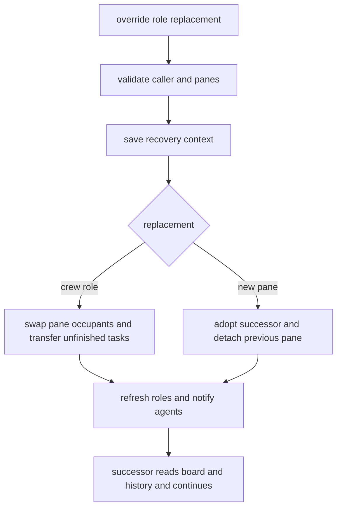

# Role overrides

```sh
crew -s voucher override lead impl   # promote the running implementation agent
crew -s voucher override lead %12    # take over from an agent in a new pane
crew -s voucher override lead=pi     # spawn and verify a fresh successor
```

Manual mid-work recovery when a role hits a usage limit. Only `you` or the
current `lead` may invoke it; sender identity remains advisory. Both existing
crew panes must pass `owns_pane`; a new pane must be unlabelled. Validation
runs under `.panes.lock` and `.board.lock`, before changing bindings. For
`<role>=<cli spec>`, a bare value is a CLI command; only `%pane` adopts a pane
in that form. The shared spawn helper launches and verifies the CLI without a
roster lock. It closes a failed pane; after relocking, a changed roster also
closes the new pane and leaves the old binding in place. Caller identity is
checked again after acquiring the locks; the shared lock helper cleans up all
locks acquired by a command, including on validation failure. `task set` also
refreshes identity under its board lock. Both TSV
rewrites are prepared before publishing; updates are not crash-atomic across
files.

- An existing replacement swaps occupants with the overridden role. CLI and
  spawned/adopted origin follow the pane. Its unfinished board rows move to
  the overridden role; existing tasks for that role remain there. Done and
  cancelled rows, result paths, dependencies and evidence stay unchanged.
  Recorded native session IDs and role directories move with their panes.
  Each task keeps its own snapshotted gate directory across ownership changes.
- A new pane replaces the binding with `origin=adopted`; a CLI started by
  `role=spec` uses `origin=spawned`. In both cases the previous pane is
  unlabelled and kept open. Before a spawned successor starts, crew records
  its launch epoch with no session ID. A later crew command lazily captures
  one unique new session after the intro creates its file. Board ownership is
  unchanged.
- Save the old pane's visible output and up to 200 scrollback lines to
  `out/override-<role>-<timestamp>-<pid>.md`, with recovery instructions.
  Private conversation history is unavailable: the successor must read the
  board, channel log, relevant inboxes, results and evidence.
- Refresh rendered role files and pane labels, log the override, notify all
  roles. Inboxes retain their history under the original role names.
  Startup dialogs receive no typed input; the notice stays in the inbox.
  A calling pane receives its own notice on stdout rather than a doorbell.
- The old agent must stop its previous work and wait for a new assignment.
  Crew changes routing and instructions; it does not interrupt an active turn.
- `resolve_me` uses current pane bindings before `CREW_AGENT`, since running
  processes retain the role environment from startup. An owned env-role hint
  is accepted only without a calling pane or with a gone/foreign-crew pane;
  deliberately detached unlabelled panes stay outside (see [messaging.md](messaging.md)).



Related: [lifecycle.md](lifecycle.md), [sessions.md](sessions.md), [worktrees.md](worktrees.md).
