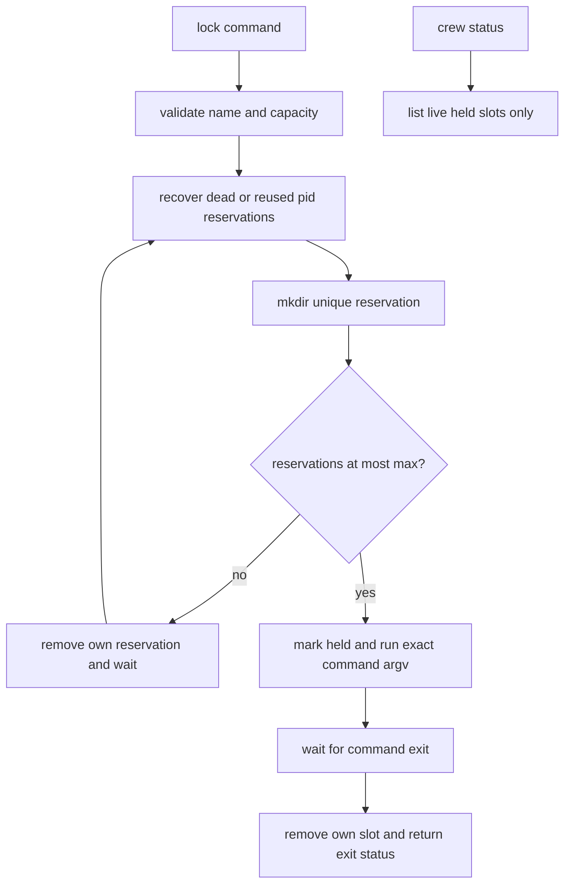

# Command semaphores

`crew lock` runs a command with a crew-scoped concurrency bound. The sourced
`share/crew/semaphore.sh` module is separate from `lock`/`unlock`, which
protect board and pane file rewrites.

```sh
crew lock -- ./gradlew build
crew lock --name checks --max 2 -- ./run-checks
crew status  # active namespace, pid, role and command
```

Default name is `build`, capacity 1. `--max` is a positive integer up to
999999; leading zeros are decimal. Namespace names follow crew name rules.
The first use atomically creates `locks/<name>/max` with shell noclobber.
All later callers must request the same capacity; use another name for a
different bound. Capacities persist for the crew's lifetime. Namespace and
crew boundaries are independent. Ended crews reject new/waiting commands.

Admission reserves a unique directory (`mktemp -d`, using mkdir) under
`locks/<name>/slot.<pid>.<random>/` **before** counting reservations. At most
N reservations can pass the count; an excess contender removes its own
reservation and retries after a short randomized delay. Contention may
briefly underfill slots; no FIFO/fairness contract is promised. One stderr
line reports waiting. There is no global coordinator or stale recovery lock
that could itself strand a namespace.



`owner` contains pid, process start time, role and flattened command text.
Before metadata publication, the pid in the directory name protects a live
reservation. Recovery checks pid liveness and then the recorded start time,
so a reused pid does not keep a stale slot. It never signals a recovered pid.
Unique slot paths are never republished by another contender, avoiding a
stale cleanup deleting a successor's reservation. Status is read-only and
shows only live slots marked `held`.

Commands receive exact argv, stdin/stdout/stderr and return their exit code.
Normal exit and failures release the slot. SIGINT/SIGTERM handling terminates
and waits for the direct command before exiting with 130/143 and removing
the reservation. This is process-lifetime coordination, not a limit on
independently detached descendants. SIGKILL leaves a stale reservation for
later acquisition to recover.

`test/smoke.sh` sources `test/semaphore.sh`: real overlapping jobs, a blocked
third contender, bursts under a capacity bound, independent namespaces,
capacity conflicts, stdin/argv/error/exit handling, unpublished live slots,
dead/reused pids, holder visibility, interruption cleanup and ended crews.
Tests use scratch crew files and a detached tmux session.

Related: [summary.md](summary.md), [tasks.md](tasks.md),
[../architecture/state-files.md](../architecture/state-files.md), [../practices.md](../practices.md).
