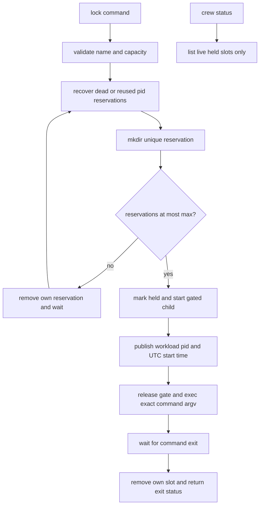

# Command semaphores

`crew lock` runs a command with a crew-scoped concurrency bound. The sourced
`share/crew/semaphore.sh` module is separate from `lock`/`unlock`, which
protect board and pane file rewrites.

```sh
crew lock -- ./gradlew build
crew lock --name checks --max 2 -- ./run-checks
crew status  # active namespace, wrapper/command pids, role and command
```

Default name is `build`, capacity 1. `--max` is a positive integer up to
999999; leading zeros are decimal. Namespace names follow crew name rules.
The first use atomically creates `locks/<name>/max` with shell noclobber.
All later callers must request the same capacity; use another name for a
different bound. Capacities persist for the crew's lifetime. Namespace and
crew boundaries are independent. Ended crews reject new/waiting commands.

Admission reserves a unique directory (`mktemp -d`, using mkdir) under
`locks/<name>/slot.<pid>.<random>/` **before** counting reservations. At most
N reservations can pass the count; an excess contender removes its own
reservation and retries after a short randomized delay. Contention may
briefly underfill slots; no FIFO/fairness contract is promised. One stderr
line reports waiting. There is no global coordinator or stale recovery lock
that could itself strand a namespace.



`owner` contains wrapper pid, process start time, role and flattened command
text. Before metadata publication, the pid in the directory name protects a
live reservation. `workload` records the direct command pid and start time.
All recorded and compared identities use `LC_ALL=C TZ=UTC ps -o lstart=`, so
another caller timezone/locale cannot falsely recover a live slot. Recovery
retains a reservation while either wrapper or workload is live. It never
signals a recovered pid. Status is read-only and lists wrapper/command pids
for live slots marked `held`.

The workload starts as a new shell waiting on the slot's `run` marker. The
wrapper publishes its child's identity **before** releasing that gate. The
child then execs the exact command argv, retaining the same pid/start time.
If the wrapper dies before publication, the gate exits on parent death, a
missing slot, or a bounded readiness wait; user code never starts. If the
wrapper is SIGKILLed after publication, the surviving direct command keeps
its reservation until it exits. Unique slot paths are never republished by
another contender, so stale cleanup cannot delete a successor's reservation.

Commands receive exact argv, stdin/stdout/stderr and return their exit code.
Normal exit and failures release the slot. SIGINT/SIGTERM handling terminates
and waits for the direct command before exiting with 130/143 and removing
the reservation. This covers the direct command lifetime, not independently
detached descendants. SIGKILL of only the wrapper leaves the live workload
lease; later acquisition recovers it once both processes are gone.

`test/smoke.sh` sources `test/semaphore.sh`: real overlapping jobs, a blocked
third contender, bursts under a capacity bound, independent namespaces,
capacity conflicts, stdin/argv/error/exit handling, unpublished live slots,
dead/reused pids, cross-timezone contention, SIGKILL with a surviving direct
command, holder visibility, interruption cleanup and ended crews.
Tests use scratch crew files and a detached tmux session.

Related: [summary.md](summary.md), [tasks.md](tasks.md),
[../architecture/state-files.md](../architecture/state-files.md), [../practices.md](../practices.md).
