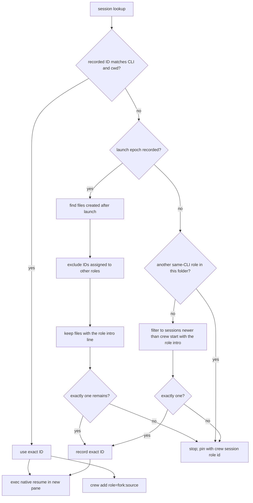

# Native agent sessions

`crew resume <role>` restarts the role's native conversation in the current
tmux pane. Run it from a new, unbound pane after the old role pane is gone or
unlabelled. It changes that role's roster binding to the current pane, marks
it adopted, changes to the crew's recorded project directory and execs the
CLI's native resume command. It sends no intro because the conversation
already contains its context. `crew rebind` only changes the pane mapping.

```sh
crew -s pr42 session lead                 # show/pin a safely discovered ID
crew -s pr42 session rev 8eaf…            # pin a known ID when lookup is ambiguous
crew -s pr42 resume lead                  # run inside a new unbound tmux pane
crew -s pr42 add rev2=fork:lead           # start a new role from lead's context
```

## Recovery after a reboot

Inspect `crew ls` and `crew -s <name> status` first. A dead role or a reused id
needs explicit recovery; do not adopt a process just because its CLI matches.
If its conversation is already running in another pane, use `rebind`. Otherwise
open a new unbound pane, inspect/pin `crew -s <name> session <role> [id]`, then
run `crew -s <name> resume <role>` there. Repeat per role. No native transcript
means resume cannot reconstruct it: launch the user's exact recorded spec in a
fresh pane, `rebind <role> <pane> --intro`, then recover from board/log/results.
Do not add flags or guess IDs. Resume keeps the recorded launch spec and adds
only native conversation-selection arguments.

A private-server smoke fixture ends its sole tmux session, starts a new server
with the same pane id and same `cat` CLI but no ownership labels, and verifies
status/listing mark it reused, send retains the inbox without ringing, and down
leaves the unrelated pane open. This reproduces id reuse safely. It does not
establish how the historical personal-site worker regained matching labels.
Restored matching crew/role labels count as owned; `alive` is an ownership check,
not proof of responsiveness. See [messaging.md](messaging.md#ownership-guard-owns_pane).

## Discovery and ambiguity

IDs come from the CLI's native store under the current user's home. Crew uses
the role's recorded CLI and the crew's `meta cwd`:

| CLI | Store lookup | Native resume command |
|---|---|---|
| Claude Code | `~/.claude/projects/<cwd with non-alphanumeric chars changed to ->/*.jsonl`; ID is the filename | `claude --resume <id>` |
| Codex | `~/.codex/sessions/**/rollout-*.jsonl`; match `cwd` and read `payload.id` from session metadata | `codex resume <id>` |
| pi | `~/.pi/agent/sessions/--<cwd slug>--/*.jsonl`; ID is the filename suffix | `pi --session <id>` |

`CLAUDE_CONFIG_DIR`, `CODEX_HOME`, `PI_CODING_AGENT_DIR` and
`PI_CODING_AGENT_SESSION_DIR` are honored when set. Spawned roles in `up`,
`add` and `override` record their launch epoch and an empty ID before the CLI
starts. Session files are lazy on the real CLIs, so crew does not scan at
settle time. When a role runs a crew command, and when `session` or `resume`
looks up a role, crew checks for files whose creation time is at or after that
launch epoch (`stat -f %B`, with a platform fallback). Before reading file
headers, `find -mmin` prunes files whose modification time predates the launch
window, rounded up with one minute of slack; the creation-time check remains
the final cutoff. A candidate counts only if its file contains the role's intro
line (`You are agent '<role>' in crew '<crew>'`), so the human's own sessions,
`claude -p` helpers and other roles' files never match; this also lets
same-CLI roles launched together each find their own file. It records only
one unassigned candidate; zero or multiple matches leave the ID unset. This also handles same-CLI roles launched
separately once an earlier role's ID has been recorded.

If an exact ID is already recorded for the role, crew uses it. Otherwise,
fallback discovery considers only native sessions created at or after the
crew's `created_epoch` (or its `created` timestamp for older crews), and only
when no other role with the same CLI shares that project folder, and only
files with the role's intro line; two such files make it refuse. If same-CLI
roles share a folder, lookup fails with a command to pin the intended ID using
`crew session <role> <id>`. Explicit IDs are checked for safe characters but
not verified against a provider API.

Exact IDs and pending launch epochs live in `sessions.tsv` as
`role<TAB>cli<TAB>cwd<TAB>session-id<TAB>launch-epoch`. The fifth field is
optional for older records. The CLI and cwd are part of the key so an old
record is ignored after either changes. A user can inspect or replace a
mapping with `crew session <role>` or `crew session <role> <id>`; the latter
serializes with pane roster writes. If a pending role has no unique new
session, lookup refuses and tells the user to pin its ID explicitly.
`crew session <role> <id>` refuses an ID already recorded for another role.
A role's row is dropped when its binding changes to a pane crew did not spawn
(`rebind`, `remove`, adopting `add`, adopting `override`), so a new occupant
never inherits the previous one's conversation.

`crew resume` checks that the CLI's first word resolves in a non-interactive
bash (aliases and functions don't) before touching the roster. It accepts the
role's own labelled pane once no agent runs there, and a pane id that matches
another role's dead row. Limit: the recorded spec is extended verbatim
(`--resume <id>`), so compound specs (`a; b`) and specs ending in a prompt
argument misbehave. A role that crashed before its first input has no
transcript: pin its ID or re-spawn it instead of resuming; adopted pi or node-wrapped codex record `node` and refuse.

## Forking a role

`crew add <new-role>=fork:<source-role>` uses the source role's exact session
ID to start a new native conversation with its existing context:

| CLI | Native fork command |
|---|---|
| Claude Code | `<source CLI spec> --resume <id> --fork-session` |
| Codex | `<source CLI spec> fork <id>` |
| pi | `<source CLI spec> --fork <id>` |

The source ID uses the same recorded-ID and ambiguity rules as `crew resume`.
The new role keeps the source CLI spec so later resume does not repeat the fork
operation. Crew records its launch epoch with a blank session ID before
starting the fork; a later role command lazily captures the new ID after the
CLI creates its native file. If capture is ambiguous, pin it with
`crew session <new-role> <id>` before resuming.



Session discovery is best-effort and follows current CLI file layouts. A
missing or ambiguous transcript does not change the roster. Resume requires
the project directory and native session file to remain available. See
[lifecycle.md](lifecycle.md), [../architecture/state-files.md](../architecture/state-files.md)
and [../agents/summary.md](../agents/summary.md).
