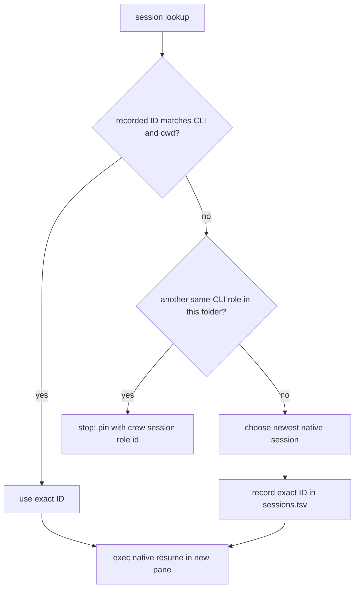

# Native agent sessions

`crew resume <role>` restarts the role's native conversation in the current
tmux pane. Run it from a new, unbound pane after the old role pane is gone or
unlabelled. It changes that role's roster binding to the current pane, marks
it adopted, changes to the crew's recorded project directory and execs the
CLI's native resume command. It sends no intro because the conversation
already contains its context. `crew rebind` only changes the pane mapping.

```sh
crew -s pr42 session lead                 # show/pin a safely discovered ID
crew -s pr42 session rev 8eaf…            # pin a known ID when lookup is ambiguous
crew -s pr42 resume lead                  # run inside a new unbound tmux pane
```

## Discovery and ambiguity

IDs come from the CLI's native store under the current user's home. Crew uses
the role's recorded CLI and the crew's `meta cwd`:

| CLI | Store lookup | Native resume command |
|---|---|---|
| Claude Code | `~/.claude/projects/<cwd with / changed to ->/*.jsonl`; ID is the filename | `claude --resume <id>` |
| Codex | `~/.codex/sessions/**/rollout-*.jsonl`; match `cwd` and read `payload.id` from session metadata | `codex resume <id>` |
| pi | `~/.pi/agent/sessions/--<cwd slug>--/*.jsonl`; ID is the filename suffix | `pi --session <id>` |

`CLAUDE_CONFIG_DIR`, `CODEX_HOME`, `PI_CODING_AGENT_DIR` and
`PI_CODING_AGENT_SESSION_DIR` are honored when set. If an exact ID is already
recorded for the role, crew uses it. Otherwise, discovery takes the newest
native session only when no other role with the same CLI shares that project
folder, then stores that exact ID. If same-CLI roles share a folder, lookup
fails with a command to pin the intended ID using `crew session <role> <id>`.
Explicit IDs are checked for safe characters but not verified against a
provider API.

Exact IDs live in `sessions.tsv` as `role<TAB>cli<TAB>cwd<TAB>session-id`.
The CLI and cwd are part of the key so an old record is ignored after either
changes. A user can inspect or replace a mapping with `crew session <role>` or
`crew session <role> <id>`; the latter serializes with pane roster writes.



Session discovery is best-effort and follows current CLI file layouts. A
missing or ambiguous transcript does not change the roster. Resume requires
the project directory and native session file to remain available. See
[lifecycle.md](lifecycle.md), [../architecture/state-files.md](../architecture/state-files.md)
and [../agents/summary.md](../agents/summary.md).
