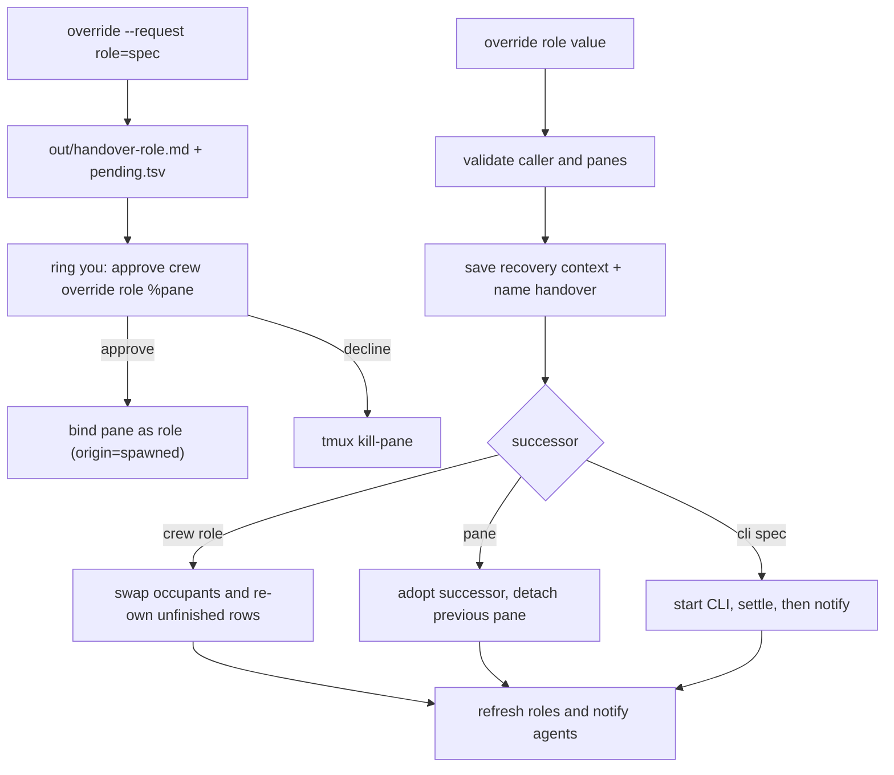

# Succession

`crew override` hands a role's ongoing work to another agent when it stalls,
dies or hits a provider limit. It changes the roster: only `you` or the current
`lead` may run the direct forms, every pre-existing pane it touches must pass
`owns_pane` ([messaging.md](messaging.md)), and sender identity stays advisory.
A pane the command itself just created is typed into with `ring --now` by
construction, since a fresh id cannot yet be stale. A worker whose lead is
unreachable can still prepare a succession with `--request`. Removing a dead
or finished role instead is `crew remove` ([lifecycle.md](lifecycle.md)).

```sh
crew -s voucher override lead impl           # swap occupants: impl becomes lead
crew -s voucher override lead %12            # an unlabelled pane becomes lead
crew -s voucher override lead=pi             # spawn a pi pane and make it lead
crew -s voucher override --request lead=pi   # any member asks; you approve
crew -s voucher rm rev2                      # drop a dead/finished role
```

| Form | Successor | Roster then |
|---|---|---|
| `override <role> <role>` | existing crew role; occupants swap | both rows keep their pane origin |
| `override <role> <pane>` / `<role>=%pane` | unlabelled tmux pane | row becomes `origin=adopted` |
| `override <role>=<cli spec>` | pane crew spawns in the crew window | row becomes `origin=spawned` |
| `override --request` (either form) | prepared, not bound | unchanged; `pending.tsv` tracks a spawn |

The `<role>=<value>` form resolves `<value>` as an existing role name first,
then `%id` as a pane, then anything else as a CLI spec. A bare word is never a
tmux ref there, so `lead=pi` cannot grab a window literally named `pi`. The
two-argument form keeps the historical role-or-tmux-ref lookup.

Validation runs under `.panes.lock` and `.board.lock`, before changing
bindings. Caller identity is checked again after acquiring the locks (the same
advisory pattern as `task set`). The shared lock helper cleans up all locks a
command acquired, including on validation failure. Both TSV rewrites are
prepared before publishing; updates are not crash-atomic across files.

## What an override does

- An existing replacement swaps occupants with the overridden role. CLI and
  spawned/adopted origin follow the pane. Unfinished board rows owned by the
  replacement are re-owned under the overridden role name — the name the
  successor now holds; tasks already owned by that role stay. Completed rows,
  result paths, dependencies and evidence stay unchanged.
- `<role> %12` and `<role>=%12` replace the binding with `origin=adopted`; a
  spawned spec records `origin=spawned`. The previous pane is unlabelled and
  kept open, as with `rebind`. Board ownership is unchanged.
- Save the old pane's visible output and up to 200 scrollback lines to
  `out/override-<role>-<timestamp>-<pid>.md`, with recovery instructions.
  Private conversation history is unavailable: the successor must read the
  board, channel log, relevant inboxes, results and evidence.
- If `out/handover-<role>.md` exists, both the recovery file and the
  successor's takeover message name it as the first thing to read. A stopping
  worker writes that file ([../roles/summary.md](../roles/summary.md));
  `--request` writes it from the old pane capture when it is absent.
- A spawned successor is started and verified (`ring --now`, `wait_ready`,
  `detect_cli`) before the role is bound. A spec that dies at the shell is
  reported, its pane closed and the roster left unchanged; nothing is typed
  into a bare shell. The settled successor then gets the intro and the
  takeover message.
- Refresh rendered role files and pane labels, log the override, notify all
  roles. Inboxes retain their history under the original role names.
  Startup dialogs receive no typed input; the notice stays in the inbox.
  A calling pane receives its own notice on stdout rather than a doorbell.
- The old agent must stop its previous work and wait for a new assignment.
  Crew changes routing and instructions; it does not interrupt an active turn.
- `resolve_me` uses current pane bindings before `CREW_AGENT`, since running
  processes retain the role environment from startup. An owned env-role hint
  is accepted only without a calling pane or with a gone/foreign-crew pane;
  deliberately detached unlabelled panes stay outside
  (see [messaging.md](messaging.md)).

## `crew override --request`

Any crew member may run it. It never changes bindings or labels:

1. validates the role and resolves the successor value like the direct form;
2. writes `out/handover-<role>.md` with the old pane's visible output when
   that file does not exist yet (an existing handover is never overwritten);
3. for a CLI spec, spawns the pane in the crew's window, records
   `role⇥pane⇥cli⇥timestamp` in `pending.tsv` immediately, types the spec and
   waits for the CLI to settle. A failed start reports the pane's last line
   and removes the pending row;
4. logs `dm <role> → you` and rings `you` with the successor, the handover
   path and the approval command. A spawned pane gets
   `crew -s <name> override <role> %pane` plus a decline hint
   (`tmux kill-pane -t %pane`); a role or `%pane` value gets that role name
   or pane in the approval command instead.

`crew status` lists pending panes with the same approval command. The
approving override clears the pending row and records `origin=spawned` for a
pane this crew started (and refuses a pane whose pending row names another
role). A pending pane has no label and no roster row, so `down` leaves it
alone — it cannot be ownership-checked and closing it could hit a reused pane
id — but down does name the pane it left open. Rows are not expired
automatically: after a tmux server restart a stale row's pane id may point at
an unrelated pane, so check `crew status` before approving. Close an unwanted
pane with `tmux kill-pane -t %pane`; approval is refused once the crew ended.



Verification is in `test/smoke.sh`: the refusal text (including the
`role=spec` form), the swap and new-pane paths, `role=spec` spawn, rollback of
a failed successor and detach, handover-file naming, and the
request/approve/pending flow.

Related: [lifecycle.md](lifecycle.md), [watch.md](watch.md),
[../roles/summary.md](../roles/summary.md),
[../architecture/state-files.md](../architecture/state-files.md).
