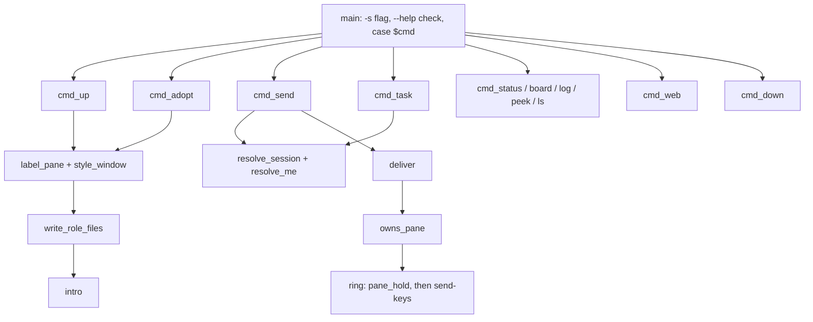

# CLI (`bin/crew`)

One Bash entrypoint, one `cmd_*` function per command, dispatched at the bottom.
`ls`/`sweep` and their two helpers are sourced from `share/crew/listing.sh`
via `CREW_SHARE`; the pane readers, `pane_hold`, the `ring` doorbell and its
draft hold come from `share/crew/pane.sh` the same way. Status observations
and the foreground watcher come from `share/crew/watch.sh`; detached timer
workers live in `share/crew/timers.sh`; command semaphores and holder listing
live in `share/crew/semaphore.sh`. See [listing.md](listing.md),
[messaging.md](messaging.md), [watch.md](watch.md), [timers.md](timers.md)
and [semaphore.md](semaphore.md).
`-s <name>` before the command selects a crew; `-h`/`--help` anywhere right
after a command prints the full usage (exit 0); unknown commands exit 1.

| Command | What it does | Detail |
|---|---|---|
| `up <name> [--self R] [--here] [--in S] role=cli …` | create panes, start CLIs, send intros | [lifecycle.md](lifecycle.md) |
| `adopt <name> role=<pane> …` | label existing panes, send intros | [lifecycle.md](lifecycle.md) |
| `add role=<cli spec\|%pane> …` | spawn or adopt new roles in a running crew | [lifecycle.md](lifecycle.md) |
| `override <role> <replacement-role\|pane>` / `<role>=<cli spec>` | hand ongoing work to another agent or spawn a successor | [lifecycle.md](lifecycle.md) |
| `remove <role> [--keep-pane]` | drop a role: block its open tasks, close/unlabel its pane (lead/you only) | [lifecycle.md](lifecycle.md) |
| `rebind <role> [pane] [--intro]` | move a role to another pane (default: caller's) | [lifecycle.md](lifecycle.md) |
| `send <role[,role…]\|@all\|you> <msg>` | log + inbox + doorbell (unrung doorbells are logged) | [messaging.md](messaging.md) |
| `say <role[,role…]\|@all> <msg>` | `send`, but refuses unless the caller is the human | [messaging.md](messaging.md) |
| `note <text>` | `sys` line in the timeline | [messaging.md](messaging.md) |
| `task add --to R [--dep T] [--out out/x.md] [--msg M] <title>` | new board row + notify owner; `{id}` → the new id | [tasks.md](tasks.md) |
| `task set <id> <status> [--out F] [--evidence F] [--force]` | update row, pane label, log; `done` gate-checks F | [tasks.md](tasks.md) |
| `task next-id` | id the next `add` will take | [tasks.md](tasks.md) |
| `lock [--name build] [--max N] -- <cmd...>` | crew-wide counting semaphore | [semaphore.md](semaphore.md) |
| `board` / `status` | board table / agents, model, stuck/error notes, context/quota + lock holders + board | [tasks.md](tasks.md), [watch.md](watch.md), [semaphore.md](semaphore.md) |
| `watch [--every 120] [--quiet-after 10m] [--ring]` | debounced state-change notices, optionally ring lead | [watch.md](watch.md) |
| `at <HH:MM\|+30m> <role> <message>` / `every <30m> <role> <message>` | detached guarded doorbells | [timers.md](timers.md) |
| `timers [cancel <id>]` | list timers or stop one | [timers.md](timers.md) |
| `log [-f] [-n N]` | formatted `channel.log` | [messaging.md](messaging.md) |
| `peek <role> [N]` | last N lines of the pane (`capture-pane -J`); refuses a pane failing `owns_pane` | — |
| `inbox [role] [--last [N]] [--from R] [--since HH:MM]` | whole inbox entries; default: the caller's role (`you`: lead) | [messaging.md](messaging.md) |
| `web [--port N] [--open] [--allow-send]` | exec the Bun viewer | [../web/summary.md](../web/summary.md) |
| `restyle` | re-apply the border format to the crew's windows | below |
| `down` | close spawned panes, unlabel adopted ones, mark ended | [lifecycle.md](lifecycle.md) |
| `ls [--live]` | projects, actual pane liveness, task counts and last activity | [listing.md](listing.md) |
| `sweep [--apply]` | dry-run stale cleanup, or mark stale crews ended without touching panes | [listing.md](listing.md) |
| `whoami`, `path` | caller identity + `why:` reason, crew dir | — |



## Environment knobs

| Variable | Default | Use |
|---|---|---|
| `CREW_HOME` | `~/.crew` | crew state root (tests point it at a temp dir) |
| `CREW_SHARE` | `<script dir>/../share/crew` | listing module + templates + web files |
| `CREW_BOOT_WAIT` | `30` | max seconds to wait for a new CLI to settle |
| `CREW_RING_WAIT` | `30` | draft wait budget; `0` checks once and refuses a busy pane immediately, capped at `3600` ([messaging.md](messaging.md)) |
| `CREW_NO_SWITCH` | unset | don't `select-window` after `up` (tests) |
| `CREW_WEB_PORT` | `7777` | viewer port |
| `CREW_SESSION`, `CREW_AGENT` | set in spawned panes | crew selection and fallback identity; pane bindings take precedence |
| `CREW_VIA=web` | set only by the web server | sender shown as `you (web)` |
| `CREW_WEB_ALLOW_SEND`, `CREW_BIN` | set by `crew web` | enable `/api/send`, path of `bin/crew` |

## Pane labels and border

`label_pane` sets pane options; `style_window` turns on the top border:

```sh
tmux set-option -w -t "$win" pane-border-status top
tmux set-option -w -t "$win" pane-border-format \
  ' #{?@crew_role,#[bold]#{@crew_role}#[nobold] · #{@crew_cli}#{?@crew_model, #{@crew_model},} · #{pane_id}#{?@crew_status, · #{@crew_status},},#{pane_title}} '
# → " impl · codex GPT-6-Sol · %7 · T1 working "
```

Pane *titles* are not used: Claude and Codex overwrite them via terminal
escape codes. Pane user options survive that, and move with the pane through
swaps, re-layouts and `join-pane`. The border format is a **window** option,
so a crew pane moved to another window shows its label only after that window
gets `pane-border-status top`. Windows styled before a format change keep the
old format until `crew restyle` (styles every window holding an owned pane,
refreshes models).

Status also includes idle/error notes and recognised context/quota footers,
using the shared observer in `share/crew/watch.sh`; see [watch.md](watch.md).

## Agent names (`detect_cli`)

Labels and `panes` use the program found in the pane's tty process list (the
first non-shell process in `ps -o args= -t <tty>`), falling back to
`#{pane_current_command}`. That turns Claude's `2.1.284` and pi's `node` into
`claude` / `pi` for adopted, `--self` and rebound panes. Spawned panes use the
role spec. `short_cli` still maps a bare version to `claude` for old files.

## Model detection

`detect_model` greps the last 6 non-blank screen lines for
`MODEL_RE` (`Opus|Sonnet|Haiku|Fable <ver>`, `GPT-…`, `<name> • <effort>`).
It is refreshed on intro, adopt, every delivery and every `status`. Screen
scraping breaks if a CLI changes its status bar; failure just omits the model.

Lessons:
- `tmux display-message -p '#S'` without `-t` reports the *attached client's*
  session, not the caller's; always pass `-t "$TMUX_PANE"`.
- `send-keys` text and `Enter` must be separate calls with a short pause, or
  some TUIs treat the newline as part of a paste.

Related: [../architecture/summary.md](../architecture/summary.md), [../agents/summary.md](../agents/summary.md).
