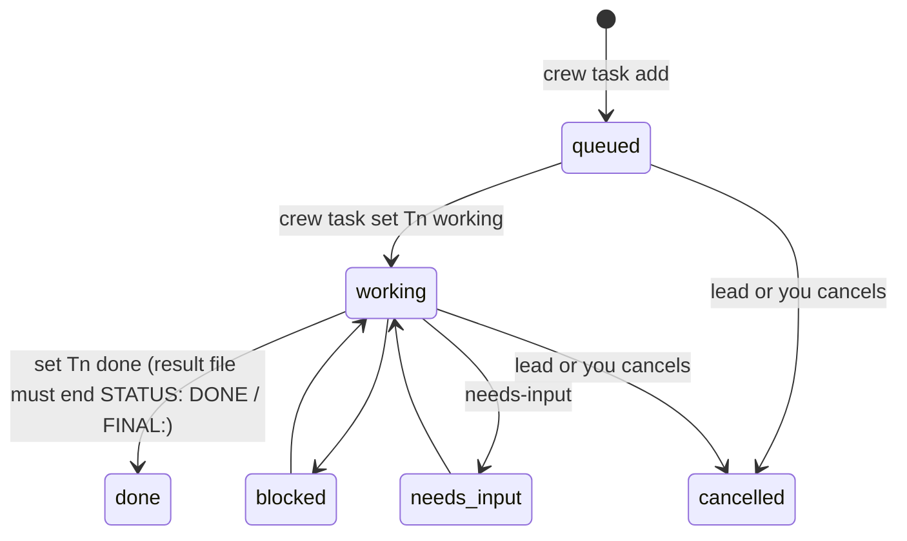
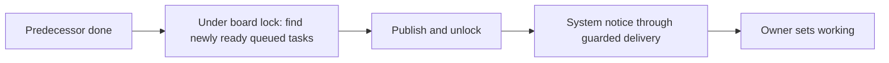

# Tasks and the board



## `crew task add --to <role> [--dep T1] [--out out/x.md] [--gate "<cmd>"] [--cwd <dir>] [--msg "…"] <title…>`

`--out` (bare `x.md` becomes `out/x.md`; anything else must match
`^out/[A-Za-z0-9._-]+\.md$`) names the task's one result file; the default is
`out/<id>-<owner>.md`. Under the board lock: id = `T<max numeric id + 1>`, append
`id⇥owner⇥queued⇥dep|-⇥out⇥title⇥-⇥gate|-⇥cwd`. The directory snapshots
`--cwd` or the owner's recorded directory; see [worktrees.md](worktrees.md). Then: log a `sys` line, set the owner's
`@crew_status` to `Tn queued`, and `crew send` the owner (so there is no need
for the lead to also message them):

```
T3 for you: <title> (needs T2) — <msg>. Write /Users/…/.crew/<name>/out/T3-rev.md
(not in your working directory), then: crew task set T3 done [--evidence <file>]
&& crew send lead "T3 done"
```

The result path is **absolute** on purpose: agents run in the repo, and a
relative `out/` would create files inside the worktree (breaking reviewers'
read-only rule). Prints the new id on stdout.

`{id}` in `--out` and `--msg` is replaced with the id this add has just taken,
so a lead can name the result file before the id exists:
`--out out/{id}-fix.md`. `crew task next-id` prints the same id without adding
anything (`T<max numeric id + 1>`; `T1` on empty). Both expansions happen before the
`--out` validation, so `out/{id}.md` is checked as `out/Tn.md`.

## Dependency readiness notices

`--dep T1,T2` records a comma-separated list of prerequisites (one id works too).
Dependencies are advisory; they do not gate status updates. When a task changes
from a non-done state to `done`, the pre-update board is inspected under the board
lock. Queued rows directly depending on that id are announced only when all
other dependencies are already done. Missing dependencies are unsatisfied.
Repeated `done` is quiet. Reopening a dependency and completing it again creates
a new readiness transition. Blocked/working/done dependents receive no notice.

After the updated board is published and unlocked, `task_notify_ready` logs a
`dm` from `system` and uses `deliver` for each ready owner's inbox/doorbell. Thus
same-owner successors work, and stale panes, drafts, dialogs and modes retain
the usual protection. A skipped ring stays in the inbox with the normal warning;
a ringing watcher can replay a coalesced reminder, but no auto-start occurs. The task stays queued until its owner starts it.
Concurrent completions serialize the readiness calculation, so only the last
completion sees the transition. Delivery is best-effort after commit: a process
crash between the board update and inbox write can lose a notice.



The sourced `share/crew/tasks.sh` owns `cmd_task`, validation, board transitions
and readiness delivery; the entrypoint supplies identity and locking helpers. Tests live in
`test/dependencies.sh`, sourced by smoke.

## Ids follow the order of `crew task add` calls

The id only exists after the row does (`T<max numeric id + 1>`), and `add` immediately
messages the owner with it. Decide the numbering first and add tasks in that
order; a later add never takes an earlier id.

A wrong order is fixed at the source, not with follow-up messages: while the
affected rows are still `queued`, take `$D/.board.lock` (same lock `add` and
`set` use), rewrite `board.tsv` into the intended order, then send each owner
one final line naming its id. Once a worker has moved its id off `queued`,
leave the board as it is and re-send the mapping instead. In `ringrace` three
workers were told T1/T3/T2 by add order, then got two "correction"
messages, then the board was regenerated and each was re-told; the
corrections were the wasted half — the timeline showed ids that no longer
existed.

A `--msg` that *also* names a path would still conflict; `lead.md` tells the
lead to name paths only with `--out` (pi once wrote both files when it wasn't).

## `crew task set <id> <status> [--out <file>] [--evidence <file>] [--force]`

Status must be `queued|working|done|blocked|needs-input`. Only the task's
owner, `lead` or `you` may set it (advisory, like sender labels: it stops a
worker closing someone else's task by mistake). An unresolved (`outside`) caller
fails before any gate or board write, even with `--force`, with the deciding
identity failure and a `whoami`/per-call hint. Identity is refreshed under the
lock before authorizing the update. Under the lock,
rewrites the row via `awk` → `board.tsv.tmp` → `mv`; `--evidence` fills
column 7 (old 6-column rows gain it). Then updates the owner's
pane label (only if `owns_pane`) and logs `"<caller> set Tn → status (file)"`
(plus `[forced]` when `--force` was used).

### `done` gate: the result file must say so

`set … done` reads the effective result file (`--out`, else column 5) and
requires its **last non-empty line** to start with `STATUS: DONE` or
`FINAL:`. Otherwise the task stays open and the error quotes what the file
says:

- no file named, or the file does not exist / is blank → points at the write and at `--force`;
- last line `STATUS: BLOCKED`, `STATUS: PARTIAL`, `STATUS: NEEDS-INPUT`, … → `Tn stays open: <file> ends with '…'`;
- anything else → asks for `STATUS: DONE`/`FINAL:`.

A trailing `\r` is stripped before that check, so CRLF result files — including a
CRLF blank row after `STATUS: DONE` — behave like LF ones.

`--force` skips the check and logs `[forced]` on the `set` line, so the board
history shows the shortcut. The gate applies to `lead` and `you` too. Only
`done` is gated; moving a task to `blocked` still does not need an exit file.

### `--gate "<cmd>"`: a command that must pass for `done`

Stored (one line) in column 8. `set … done` runs it with `bash -c` in the task's
recorded directory **before** taking the board lock, so a slow test run
can't make other writers time out; only for a caller allowed to set the task.
Output goes to `out/<id>-gate.log` (`# cwd`, `$ cmd`, output, `[exit N]`) and becomes the
evidence unless `--evidence` is given. Non-zero exit: `Tn stays open: gate … exited N`.
Only `lead`/`you` may add a gate, and only the task's owner runs it (in the
owner's own shell and permissions); lead/you marking a gated task done are
refused unless `--force`. A gate guards against honest mistakes, not proof: the
owner can fake its own log, and role labels are advisory.
`--force` skips the gate like the result-file check. Other statuses never run it.

## Cancellation and dependency edits

```sh
crew task cancel T3 --reason "Queued against the wrong scope"
crew task dep T4 T1,T2
crew task dep T4 -                 # remove every prerequisite
```

Both commands are lead/you only, refresh identity under `.board.lock`, publish
with the existing atomic board rewrite, and retain every task row. `cancel`
changes an open task to terminal `cancelled`, logs the optional reason, tells
its owner to stop and lists dependents with the repair command. Repeating it
is quiet; done history cannot be cancelled. A cancelled row cannot be reopened
with `task set`, even with `--force`; a late gate completion cannot resurrect it.
Already-cancelled tasks are rejected before starting their gate too.

Cancelled counts as closed for listing, watch and task transfers, but never
satisfies a dependency. `dep` replaces an open task's complete prerequisite list
with existing IDs or `-`; malformed/unknown IDs, self-dependencies and cycles
are refused. Removing the last unmet prerequisite notifies a queued owner once
through the usual guarded path, after unlocking. Existing done/working work is
not auto-started. IDs are allocated above the largest existing numeric ID, so
removing an interior row cannot cause a collision; cancellation keeps its row.

## Locking

```sh
lock board   # mkdir "$D/.board.lock" (retry 50 × 0.1 s, then die); trap 'rmdir …' EXIT
unlock board # also used as: lock panes / unlock panes (crew rebind)
```

Without it, two concurrent `task set`s lost an update and two `task add`s
could get the same id. `test/smoke.sh` runs 15 parallel adds and 15 parallel
sets. A crash between `mkdir` and the trap could leave a stale lock; the die
message names the directory to remove.

## `crew board` / `crew status`

`board` prints `ID OWNER STATUS NEEDS OUTPUT EVIDENCE TITLE` via `column -t`
(title last so long titles don't push columns). `status` prints
`ROLE CLI MODEL PANE RUNNING LAST-MESSAGE NOTE CONTEXT/QUOTA` for every role
(RUNNING is the short cli, `gone`, or `STALE (pane reused)`), then any active
command semaphore holders (wrapper/command pids, role and argv) and the board.
See [semaphore.md](semaphore.md).
The last message is capped at 70 Unicode characters via `truncate_text`
(Bash substring with `en_US.UTF-8`), rather than BSD awk's byte-based
`substr`: cutting a UTF-8 sequence makes BSD `column` drop the roster rows.
Timestamp-only `awk substr` calls slice ASCII and are safe.

## Result file contract (from protocol.md)

- Path `~/.crew/<name>/out/<task>-<role>.md`.
- Last line exactly `STATUS: DONE|BLOCKED|NEEDS-INPUT`; reviewers
  `FINAL: AGREE|DISAGREE`. Tools (the web viewer, the lead) key on these, and
  `task set … done` refuses to close a task whose file does not end that way
  (`--force` overrides; see above).
- Claims that something was run or verified need an evidence file (command +
  output, e.g. `out/T3-tests.log`) attached with `--evidence`. The lead treats
  claims without one as unverified; the web board shows `no evidence` on done
  tasks that lack it. Found in use: a brief said "verified E2E, 150 tests"
  while the PR said "not checked in a browser, 147".

`task set` resolves caller identity again after taking `.board.lock`, so a
role override while it waits cannot retain the previous lead privilege.

Related: [messaging.md](messaging.md), [../architecture/state-files.md](../architecture/state-files.md).
