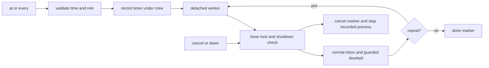

# Timed doorbells

`share/crew/timers.sh` is sourced by `bin/crew`. `at` and `every` start a
`nohup` worker process through the private `_timer <id>` entrypoint. There
is no shared scheduler service. Stdout prints the assigned timer id and
returns immediately; worker streams are redirected to its recorded log.

```sh
crew at 03:00 lead "start checks"    # next local occurrence
crew at +30m lead "check workers"
crew every 30m lead "review board"  # first ring after 30 minutes
crew timers
crew timers cancel timer-1234567890-12345
```

Relative delays and repeat intervals are positive integer seconds with an
optional `s`, `m`, `h` suffix (leading zeros are decimal). `HH:MM` is local
wall time: a time already passed today moves to tomorrow. BSD `date` parses
the date and calendar day, including timezone rules. Repeats schedule the
next interval after delivery; missed intervals are not replayed.

Each worker polls once per second. Its record is
`timers/timer-<epoch>-<pid>/`, with `config`, `message`, `owner`, `next`,
`ready` and `worker.log`; completion adds `done`, cancellation adds
`cancelled`. `owner` records the worker pid and process start time. Listing
shows the next local timestamp and waiting/done/cancelled/stopped and keeps the record for inspection.
The recorded message is data; no eval or shell interpolation executes it.



`.timers.lock` serializes scheduling, each delivery, cancellation and crew
shutdown. `down` marks ended and cancels timers before pane teardown.
Cancellation validates pid, start time and worker command before signalling,
so reused/unrelated processes are never killed. Workers stop on ended or
cancelled markers as well. Their signal/exit cleanup releases an owned timer
lock and stops the current sleep child. Abrupt SIGKILL during a locked
operation can leave the standard mkdir lock for manual cleanup.

Delivery uses the existing `deliver` function with sender `timer` and an
empty launching-pane hint, so scheduling the lead from its own background
shell still rings it. Ownership, dialog/copy-mode and draft checks stay in
the existing send path. Timers check drafts once (`CREW_RING_WAIT=0`); skipped
rings stay in the inbox and are logged, without automatic retry. An `at`
timer is then done even if its doorbell was held. No worker interprets a
human approval or answers a dialog. Sender labels remain advisory.

The smoke suite sources `test/timers.sh` for parsing, literal messages,
one-shot/repeated delivery, cancellation, self-pane delivery, approval and
reused-pane holds, unrelated-pid protection, and shutdown. All tests use its
scratch crew home and detached tmux session.

Related: [summary.md](summary.md), [messaging.md](messaging.md),
[lifecycle.md](lifecycle.md), [../architecture/state-files.md](../architecture/state-files.md).
