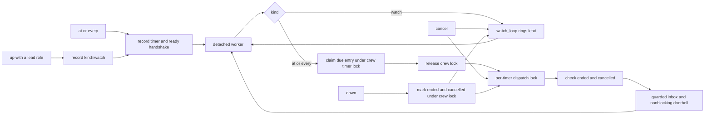

# Timed doorbells

`share/crew/timers.sh` is sourced by `bin/crew`. `at` and `every` start a
`nohup` worker process through the private `_timer <id>` entrypoint. There
is no shared scheduler service. Stdout prints the assigned timer id and
returns immediately; worker streams are redirected to its recorded log.

```sh
crew at 03:00 lead "start checks"    # next local occurrence
crew at +30m lead "check workers"
crew every 30m lead "review board"  # first ring after 30 minutes
crew timers
crew timers cancel timer-1234567890-12345
```

A record's `kind` is `at`, `every` or `watch`. `watch` records are the
detached watcher `crew up` starts for a crew with a lead
([watch.md](watch.md)): the same record, owner handshake, listing and
cancel/`down` path, but its worker runs the scan loop and rings the lead
instead of dispatching one message. It never rewrites `next`, so the listing
shows NEXT `-` for it, and reports `watching` while its worker is alive.
`up --no-watch` starts none; `CREW_WATCH_EVERY` changes the interval. All three
kinds are created by the one `timer_create` helper: timer lock, ended check,
id/directory, config/next/message, worker publication and unlock.

Relative delays and repeat intervals are positive integer seconds with an
optional `s`, `m`, `h` or `d` suffix (leading zeros are decimal), parsed by the
shared `duration` helper in `bin/crew`; `at`/`every` reject zero. `HH:MM` is
local wall time: a time already passed today moves to tomorrow. BSD `date`
parses the date and calendar day, including timezone rules. Repeats schedule the
next interval when claiming a due dispatch; missed intervals are not replayed.

Each worker polls once per second. Its record is
`timers/timer-<epoch>-<pid>/`, with `config`, `message`, `owner`, `next`,
`ready`, `claimed` and `worker.log`; completion adds `done`, cancellation adds
`cancelled`. `owner` records the worker pid and process start time. Listing
shows the next local timestamp (`-` for a watch record) and waiting/done/
cancelled/stopped and keeps the record for inspection.
The recorded message is data; no eval or shell interpolation executes it.



`.timers.lock` protects schedule publication, due-entry claims, next-time
updates and shutdown markers. Pane I/O runs **after** releasing this crew-wide
lock, so a slow recipient cannot block unrelated timers or crew lifecycle.
Each timer has its own `.dispatch.lock` shared by dispatch and cancellation.
Cancel waits for an in-flight dispatch, then marks cancelled and stops the
recorded process. `down` marks ended/cancelled under the crew lock, releases
it, then stops workers through their individual dispatch locks before pane
teardown. No dispatch can occur after cancel/down completes.

Timer rings use an internal try-lock mode (`RING_TRY_LOCK=1`): a contended
pane ring lock is refused immediately, with inbox retention and a logged
reason. Ordinary sends keep their existing ring-lock behavior. Ownership and
all draft/dialog holds remain active; this mode never bypasses a lock.

Cancellation validates pid, start time and worker command before signalling,
so reused/unrelated processes are never killed. Worker cleanup releases only
its own timer/dispatch locks and stops its current sleep child. Abrupt SIGKILL
inside a critical section can still leave a standard mkdir lock for manual
cleanup.

The launcher installs failure/signal cleanup before spawning. An unpublished
record is marked cancelled on launch failure. The worker checks launcher pid
liveness while waiting for `ready` and bounds that handshake to 50 polls of
0.1 seconds. A dead or stalled launcher cannot leave a polling orphan; the
worker records cancellation and exits. Successful publication clears launcher
cleanup and the worker continues independently.

Delivery uses the existing `deliver` function with sender `timer` and an
empty launching-pane hint, so scheduling the lead from its own background
shell still rings it. Ownership, dialog/copy-mode and draft checks stay in
the existing send path. Timers check drafts once (`CREW_RING_WAIT=0`); skipped
rings stay in the inbox and are logged, without automatic retry. An `at`
timer is then done even if its doorbell was held. No worker interprets a
human approval or answers a dialog. Sender labels remain advisory.

The smoke suite sources `test/timers.sh` for parsing, literal messages,
one-shot/repeated delivery, cancellation, self-pane delivery, approval and
reused-pane holds, unrelated-pid protection, shutdown, contended-ring cancel/down, and TERM/KILL during real launcher
publication; `test/watch.sh` covers the `watch` record kind end to end
(listing, ring, `down`, `--no-watch`, no lead role). All tests use its
scratch crew home and detached tmux session.

Related: [summary.md](summary.md), [messaging.md](messaging.md),
[lifecycle.md](lifecycle.md), [../architecture/state-files.md](../architecture/state-files.md).
