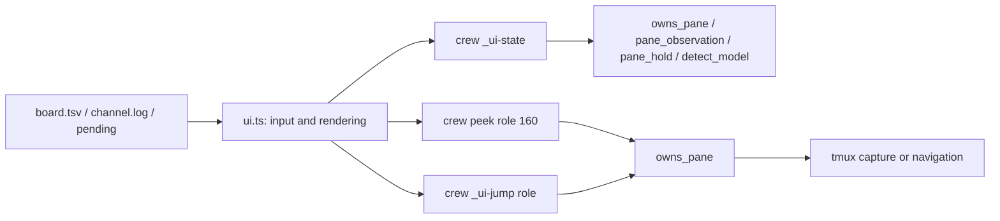

# Terminal dashboard

`crew [-s <name>] ui` is an optional Bun TUI alongside the scriptable CLI and
web viewer. It runs in a spare terminal pane, without a server or new npm
packages. The existing CLI remains the interface agents use from shell tools.

```sh
crew -s voucher ui
# ↑/↓ or j/k: select role; Tab: next non-ended crew; r: refresh
# Enter: open owned pane in this tmux session and exit; q/Esc: exit
```



## Contracts

- `share/crew/ui.sh` holds the launcher and private backend commands. It
  sources no replacement status parser. `_ui-state` emits one TSV row per
  role: `role pane cli state model resources note` (tab separated). State is
  `gone`, `stale`, or a shared observer result, with `approval`/`draft`/`mode`
  overlays from `pane_hold`; an unreadable editor is `unknown` with a note.
  Idle roles with queued/working tasks carry a warning note. All states are
  heuristics, never evidence of progress or authorization to answer a prompt.
  Free-text fields are flattened with `oneline`; the consumer rejects any row
  that does not have exactly seven fields, preserving empty trailing fields.
- The TUI shows a roster, selected-role details (open tasks, recent messages,
  printed context/quota, held doorbell count), and the tail of the selected
  pane. Held counts are not unread-message counts. A two-column summary is
  used at 110 columns and above; narrower terminals stack the summary.
- Refresh runs every two seconds without overlapping observation scans;
  requests during a scan coalesce into one immediate follow-up scan.
  selection updates the preview immediately and overlapping preview requests
  coalesce. The observation time is displayed. Tab cycles sorted non-ended
  crew directories; stale crews remain visible for diagnosis. It never
  changes `.current`. An explicit ended crew can be inspected with `-s`.
- `resolve_session --read-only` skips native-session pinning. All TUI backend
  commands and `peek` use it, so passive inspection leaves crew files and
  pane options untouched. Preview and navigation use `owns_pane`; gone or
  reused panes are never captured or opened. This follows crew's existing
  per-command ownership checks, not an atomic guarantee against concurrent
  tmux relabelling.
- Navigation selects the target window and pane only within the launching
  pane's tmux session. It refuses cross-session jumps instead of guessing an
  attached client. Cross-session previews still work; launching outside tmux
  permits inspection but navigation reports that tmux is required.
- Terminal startup requires TTY stdin/stdout and non-`dumb` TERM. Bun's
  `stripANSI`, grapheme segmentation and `stringWidth` sanitize and fit all
  external text; only the renderer adds control sequences. One column and
  row are reserved against unwanted wrapping/scrolling. Quit, Ctrl-C,
  SIGTERM/SIGHUP and process exit restore raw mode, cursor and alternate
  screen synchronously; direct command children are stopped on exit, with a
  bounded fallback if a child keeps the process alive. Unexpected failures
  restore the terminal before printing their diagnostic. SIGKILL cannot run
  teardown; use `reset` if the terminal is left in raw mode.

## Verification

`test/ui.sh` is sourced by [the smoke suite](../../test/smoke.sh). Its fixtures
use scratch crew state and detached tmux panes, never the user's live crews.
Build the optional renderer with `bun build --no-bundle share/crew/ui.ts`.

Related: [summary.md](summary.md), [watch.md](watch.md),
[messaging.md](messaging.md), [../web/summary.md](../web/summary.md).
