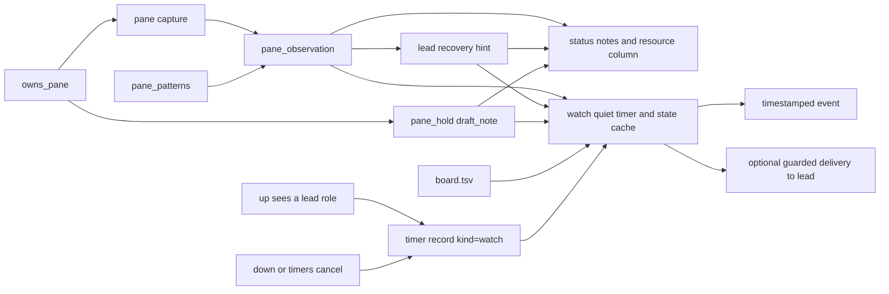

# Status observations and watch

`share/crew/watch.sh`, sourced by `bin/crew`, keeps one rendered-text pattern
table (`pane_patterns`) for `crew status` and `crew watch`. `pane_observation`
reads a capture and returns `state|resources|reason`. Scans keep pi rows raw
with `pane_scan_capture`; joining full-width pi borders with `-J` can pad the
empty editor with spaces. Whitespace-only box rows never become drafts,
while real draft rows still hold doorbells. Error patterns cover
retry/connection failures, timeouts, context exhaustion/limits, provider limits,
429 rate limits, and quota exhaustion. Errors match UI forms from the start
of a row after common UI gutters / `Error:` prefixes; crew doorbell echoes
are excluded.
Healthy quota descriptions and completed prose beginning with Working or
Thinking do not change an idle observation. Busy requires a stop/interrupt
affordance or a pi activity border. A Codex `Working (…) • esc to interrupt`
row remains busy when an empty `›` prompt is also visible, including when the
row ends with `) · 1 background terminal running · …`; the generating affordance
wins over the prompt. The last 30 nonblank rows supply errors;
the last eight supply input prompts and busy indicators (busy wins over idle).
Context and 5h percentages are shown only if printed by the CLI, including pi `42%/1.0M`,
Codex `Context 38% used · 5h 62% left`, and Claude auto-compact/context rows.
These are observations, not agent state or permission to type.

```sh
crew status
crew watch --every 120 --quiet-after 10m
crew watch --ring &  # foreground loop placed in the lead shell background
```

`crew up` starts one detached watcher by itself for every crew that has a
lead role: the same scan loop with `--every 120` and `--quiet-after 600`
ringing the lead, recorded as a timer (kind `watch`) so `crew timers` lists it
(NEXT is `-`: it scans on its interval, not a recorded due time) and
`crew down` stops it ([timers.md](timers.md)). `--no-watch` opts out, and
`CREW_WATCH_EVERY=<duration>` changes the scan interval. Every watch mode seeds
the board cache from the current board at loop start: the `board has no open
tasks` notice is a transition from open tasks to none, never a first-scan
observation, so a crew that is empty at `up` (or when a foreground watch
starts) is not announced.

`status` flags errors, pending drafts and idle input prompts with
queued/working tasks: a pane whose editor holds a draft gets
`draft pending: doorbells are held` from `draft_note`, which parses the scan's
own capture and the roster CLI through the shared `pane_editor_text`
dispatcher — no second capture and no `detect_cli` per pane — and keeps
`pane_hold`'s precedence: a captured dialog or a pane in copy/choose mode is
never read as a draft. Claude captures retain SGR so its standalone dim ghost
span can be removed; observation and dialog matching strip it before checking
their UI rows. If the lead is errored, idle with active work, or its pane is
gone/reused, `status` prints a copy-ready recovery hint from the same row
observation. `watch` appends that hint to each lead event. The hint prefers a
crew role with no open tasks and falls back to the `lead=<cli>` spawn form.
`watch` emits one timestamped stdout line per new event, or uses the lead
inbox and existing guarded doorbell with `--ring`:

- errored with an open task: <reason> (next scan, no quiet wait);
- errored: <reason> for the same error without open work — review rounds run
  over `crew send` after `done`, so an error is never silent;
- draft pending: doorbells are held (next scan, no quiet wait);
- stuck: input prompt with queued/working task (after quiet threshold);
- idle with no open task (after quiet threshold; with `--ring`, never for the
  lead itself — waiting is its normal state, and ringing it would wake it to
  idle again every quiet period);
- board has no open tasks (on the open → empty transition; a watcher that
  starts with an empty board stays quiet);

Open means any task neither `done` nor `cancelled`, including blocked/needs-input. Idle with only
blocked/needs-input work does not imply stuck. Each role/event is emitted
once until the observed event changes or clears; the empty-board notice
rearms when work reopens. Pane/text/task-row changes restart the quiet timer.
The first scan starts the timer; it cannot infer how long a pane was already
quiet. Durations are integer seconds or `s`, `m`, `h`, `d` suffixes, parsed by
the shared `duration` helper in `bin/crew` (also used by timers and
`sweep --delete-older`); interval must be positive, quiet may be zero. Default
interval is 120 seconds and quiet threshold 600 seconds.



`status` notes a recent error whether or not the role has open work; the scan
and its wording are shared, so status and watch never disagree about it.

Every scan checks ownership before reading a pane. Reused/missing panes are
skipped and their cache removed. `--ring` uses `deliver`, including
`owns_pane`, dialog/copy-mode/draft checks and inbox preservation; it checks
once (`CREW_RING_WAIT=0`) so one busy lead cannot stall scanning. Launching
from the lead pane still rings it. Failed event rings are logged and debounced
as events. A ringing watcher separately retries held deliveries as coalesced
inbox reminders after each owned-pane observation; see
[messaging.md](messaging.md#held-doorbell-reminders). It never resumes workers
or answers dialogs.

Observation/debounce state is private to a temporary directory per watcher;
concurrent watchers have independent histories. Held-delivery counters live in
the crew directory separately. Stdout mode creates no persistent crew files and
never consumes pending reminders. The loop exits on the crew's ended marker, a deleted
crew directory, SIGINT or SIGTERM, cleans its cache, and terminates its
current sleep process. The detached watcher polls its record's `cancelled`
marker too, so `down` and `crew timers cancel` stop it the same way as a
timer; it never rewrites the record's files, and `crew timers` therefore shows
NEXT `-` for it.

Verification is part of `test/smoke.sh`, via `test/watch.sh`: sample CLI
footers/errors, Codex Working and Waiting rows with a background-terminal
suffix above an empty prompt, interrupt prose, busy precedence, duration
errors, quiet/debounce transitions, empty-board transitions after startup
(including the detached watcher, which stays quiet about a board that was
already empty), guarded lead delivery/reused panes, normal-exit cleanup,
`draft pending` notes/events from the startup-draft fixtures, an error with no
open task (event and status note), and the watcher
`up` starts: record and listing (NEXT `-`, interval, an unchanged `next`), an
error ring to a lead whose worker's task is done, cancellation by `down`,
`--no-watch` and no lead role.

Related: [summary.md](summary.md), [tasks.md](tasks.md),
[messaging.md](messaging.md), [../practices.md](../practices.md).
