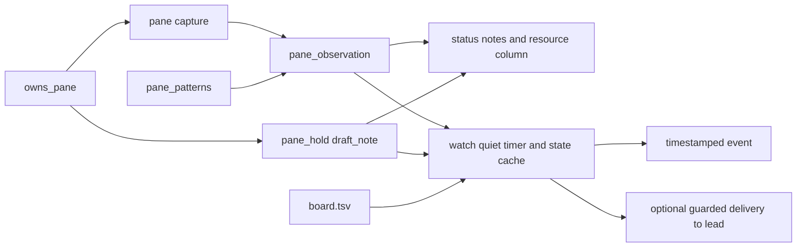

# Status observations and watch

`share/crew/watch.sh`, sourced by `bin/crew`, keeps one rendered-text pattern
table (`pane_patterns`) for `crew status` and `crew watch`. `pane_observation`
reads a capture and returns `state|resources|reason`. Error patterns cover
retry/connection failures, timeouts, context exhaustion/limits, rate limits
and quota exhaustion. Errors match UI forms from the start of a row after
common UI gutters / `Error:` prefixes; crew doorbell echoes are excluded.
Healthy quota descriptions and completed prose beginning with Working or
Thinking do not change an idle observation. Busy requires a stop/interrupt
affordance or a pi activity border. The last 30 nonblank rows supply errors;
the last eight supply input prompts and busy indicators (busy wins over idle).
Context and 5h percentages are shown only if printed by the CLI, including pi `42%/1.0M`,
Codex `Context 38% used · 5h 62% left`, and Claude auto-compact/context rows.
These are observations, not agent state or permission to type.

```sh
crew status
crew watch --every 120 --quiet-after 10m
crew watch --ring &  # foreground loop placed in the lead shell background
```

`status` flags errors, pending drafts and idle input prompts with
queued/working tasks: a pane whose editor holds a draft gets
`draft pending: doorbells are held` from `draft_note`, which parses the scan's
own capture and the roster CLI through the shared `pane_editor_text`
dispatcher — no second capture and no `detect_cli` per pane — and keeps
`pane_hold`'s precedence: a captured dialog or a pane in copy/choose mode is
never read as a draft. Claude captures retain SGR so its standalone dim ghost
span can be removed; observation and dialog matching strip it before checking
their UI rows. `watch` emits one
timestamped stdout line per new event, or uses the lead
inbox and existing guarded doorbell with `--ring`:

- errored with an open task (next scan, no quiet wait);
- draft pending: doorbells are held (next scan, no quiet wait);
- stuck: input prompt with queued/working task (after quiet threshold);
- idle with no open task (after quiet threshold);
- board has no open tasks (next scan).

Open means any task not `done`, including blocked/needs-input. Idle with only
blocked/needs-input work does not imply stuck. Each role/event is emitted
once until the observed event changes or clears; the empty-board notice
rearms when work reopens. Pane/text/task-row changes restart the quiet timer.
The first scan starts the timer; it cannot infer how long a pane was already
quiet. Durations are integer seconds or `s`, `m`, `h` suffixes; interval must
be positive, quiet may be zero. Default interval is 120 seconds and quiet
threshold 600 seconds.



Every scan checks ownership before reading a pane. Reused/missing panes are
skipped and their cache removed. `--ring` uses `deliver`, including
`owns_pane`, dialog/copy-mode/draft checks and inbox preservation; it checks
once (`CREW_RING_WAIT=0`) so one busy lead cannot stall scanning. Launching
from the lead pane still rings it. Failed rings are logged and not retried
until a new event; the watcher never resumes workers or answers dialogs.

State is private to a temporary directory per watcher; concurrent watchers
have independent debounce histories. No persistent daemon or crew files are
created by stdout mode. The loop exits on the crew's ended marker, SIGINT or
SIGTERM, cleans its cache, and terminates its current sleep process.

Verification is part of `test/smoke.sh`, via `test/watch.sh`: sample CLI
footers/errors, busy precedence, duration errors, quiet/debounce transitions,
empty board, guarded lead delivery/reused panes, normal-exit cleanup, and
`draft pending` notes/events from the startup-draft fixtures.

Related: [summary.md](summary.md), [tasks.md](tasks.md),
[messaging.md](messaging.md), [../practices.md](../practices.md).
