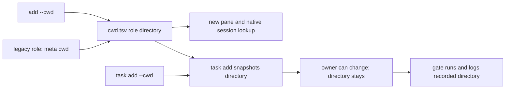

# Working directories for roles and tasks

```sh
crew add impl2=pi --cwd /path/to/second-worktree
crew task add --to impl2 --gate 'pnpm lint' 'Check the second tree'
crew task add --to impl2 --cwd /path/to/other-tree --gate 'make test' 'Check another tree'
```

`add --cwd` applies to every role in that invocation. Spawned panes start in
that directory; adopted panes stay where they are, while their recorded role
directory changes as explicitly requested. The directory must exist, resolves
to a physical absolute path, and cannot contain tabs or newlines. Spaces and
backslashes are preserved. Role CLI specs remain verbatim.

`cwd.tsv` stores `role<TAB>directory` under the panes lock, without changing
the legacy `panes` format. `role_cwd` returns that entry or the crew's `meta cwd`
for older roles. Plain additions default to the crew directory; a fork inherits
its source role's directory unless `--cwd` overrides it. Remove forgets a role's
entry. Rebind preserves the directory assigned to the role. When override swaps
two crew occupants, role directories follow their panes and native sessions;
a newly spawned successor starts in the overridden role's directory.

New tasks snapshot the effective directory in optional board column 9:
explicit `task add --cwd`, otherwise the owner's recorded directory. Only
lead/you may set an explicit task directory. Gates run there and record it at
the start of `out/<id>-gate.log`. Task ownership transfers preserve the snapshot,
so taking over another worker's task cannot silently check a different tree.
Legacy rows without column 9 fall back to their current owner's directory.
A missing gate directory keeps the task open; it never falls back to another
tree. Result and evidence paths remain relative to the crew directory.

Session pinning, discovery, lazy capture, ambiguity checks and resume use the
role directory. Same-CLI roles in different worktrees do not create folder
ambiguity. The per-role native session remains keyed by its CLI and directory.



Verification lives in `test/tasks-cwd.sh` and the session fixtures sourced by
smoke. Related: [tasks.md](tasks.md), [sessions.md](sessions.md),
[role-override.md](role-override.md), [../architecture/state-files.md](../architecture/state-files.md).
