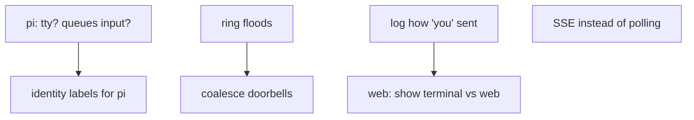

# Roadmap

Nothing from the first field report (pr357 lead) or the design discussion is
pending: rebind, whoami hint, `crew say` + sender labels, `task add --out`,
`--evidence`, `note`, `restyle`, agent-name detection, the shared crew skill,
opt-in web sending, manual mid-work role overrides, adding agents to a running
crew, UTF-8-safe status truncation, liveness/project listing and opt-in stale
cleanup and guarded identity fallback for missing/foreign tool-shell panes
and heuristic stuck/error status with a foreground watcher, provider-limit
detection and lead recovery hints for status/watch
(see [watch.md](../cli/watch.md)), detached timed doorbells (`at`/`every`,
with bounded dispatch and cancellation; see [timers.md](../cli/timers.md)) and
named command semaphores with workload lifetime tracking and holder listing
(see [semaphore.md](../cli/semaphore.md)) are all in place. Roles link to the live
roster; pane-spec resolution is
shared, and listing/cleanup lives in a sourced module (see [../lode-map.md](../lode-map.md)).
Native session discovery, launch-time epoch recording, lazy ID capture,
role resume, and forking a role's conversation are implemented; fallback
lookup is limited to sessions from the crew's start and refuses same-CLI
ambiguity. See [../cli/sessions.md](../cli/sessions.md).
What remains are open questions and candidate improvements. When one ships,
describe it in the matching lode file and delete it here.

## Open questions

- **pi**: does its shell tool have a tty (would a non-member pi be labelled
  `you (terminal)`)? Does it queue text typed during a turn?
- **Codex tool-shell identity**: answered — tool calls run through a shared,
  detached app-server daemon and inherit its stale `CREW_*`/`TMUX_PANE`
  ([../agents/codex.md](../agents/codex.md)). Candidate: detect the stale
  daemon automatically. Current recovery uses verified per-call role hints
  without restarting any shared process; unresolved task updates explain the
  failure and recovery command before gates or writes.
- **Draft detection coverage**: the ring hold reads rendered text. Claude Code's
  standalone dim ghost spans are empty; other prompt text remains a draft.
  Pi border-like draft rows can look empty with the cursor elsewhere, and
  hidden editors or typing after inspection can escape detection. Stronger
  guarantees need an editor-buffer integration, not more guessed border
  rules; see [messaging.md](../cli/messaging.md#ring-hold-never-type-into-a-draft).
- **Doorbell floods**: rings to one pane are serialized (`.ring<pane>.lock`),
  but many rings to a busy agent still become many queued prompts. Consider
  coalescing ("3 new messages, read inbox/x.md") when a ring for that pane is
  already waiting on the lock.
- **pi startup dialogs**: none seen so far; if one appears, add its footer to
  `dialog_capture` ([../cli/lifecycle.md](../cli/lifecycle.md#readiness-heuristic)).

## Candidate improvements

1. **Record the channel in the log.** `channel.log` says `from=you` for both
   terminal and web; the doorbell shows the difference, the log doesn't. A
   6th column (`via`) would let the web viewer show it; keep readers tolerant
   of 5-field lines.
2. **`crew rebind` for adopt-style bulk moves** after a tmux server restart:
   `crew rebind --all` matching roles to panes by detected cli + cwd, with a
   confirmation list.
3. **SSE for the viewer** instead of 2 s polling, only if polling cost shows up.
4. **Evidence checks**: warn in `task set … done` when a result file contains
   words like "tests pass" / "verified" but no `--evidence` was given.
5. **Context-aware completion gate**: normalize CLI percentages that report
   context used versus context left before warning or gating `task set … done`;
   `status` currently preserves the raw CLI-specific value.

Related: [declined.md](declined.md), [../summary.md](../summary.md).
